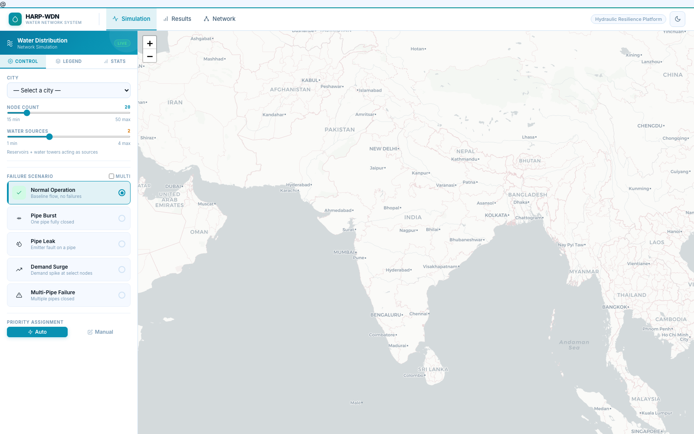
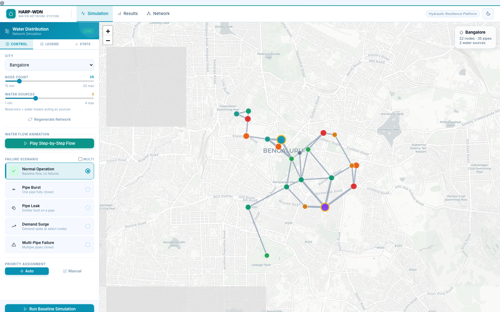
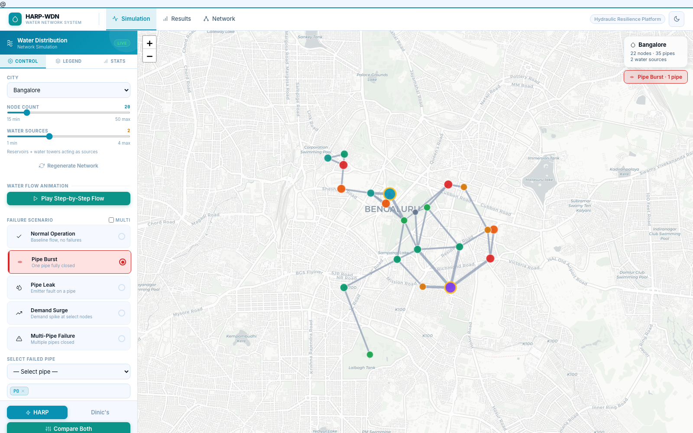
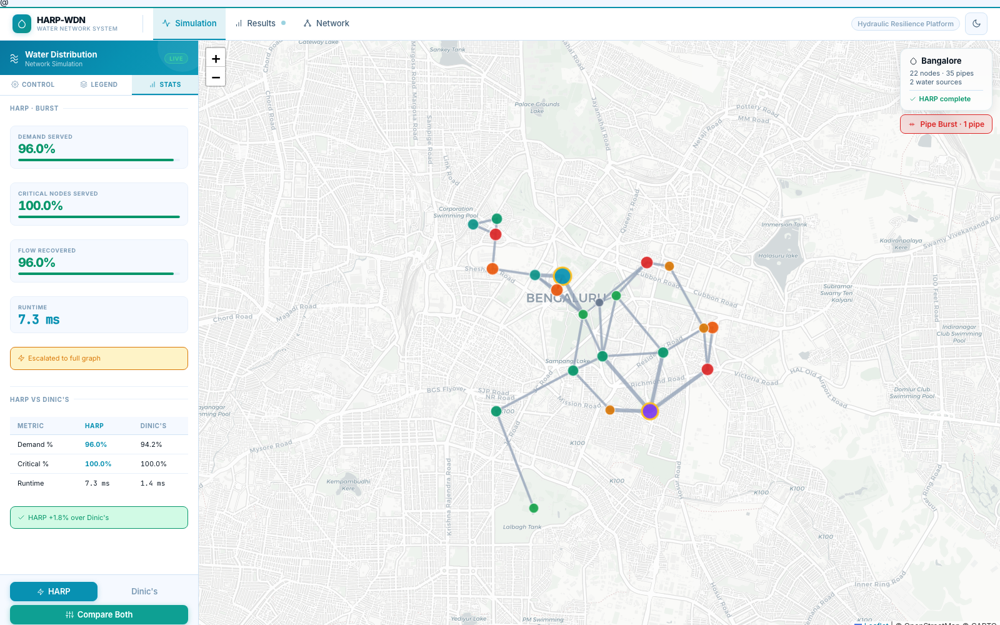
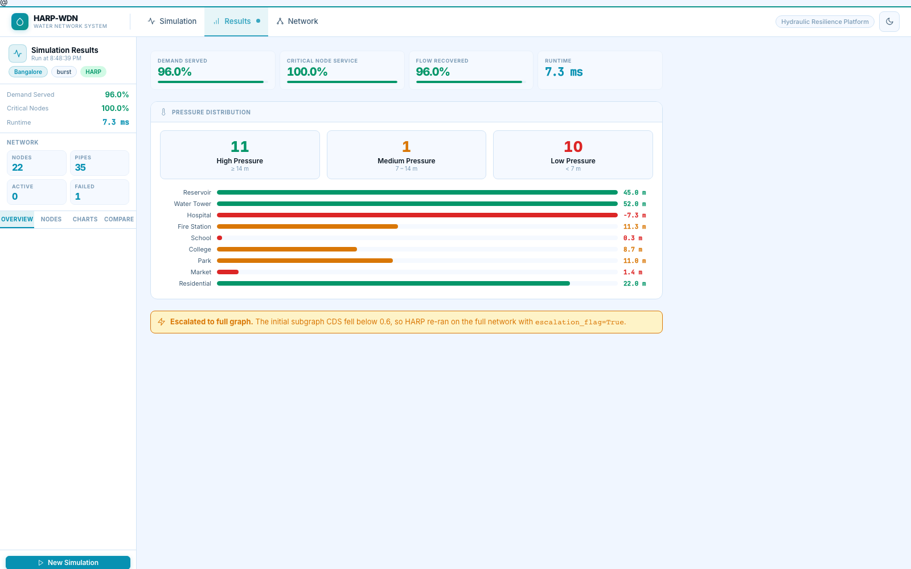
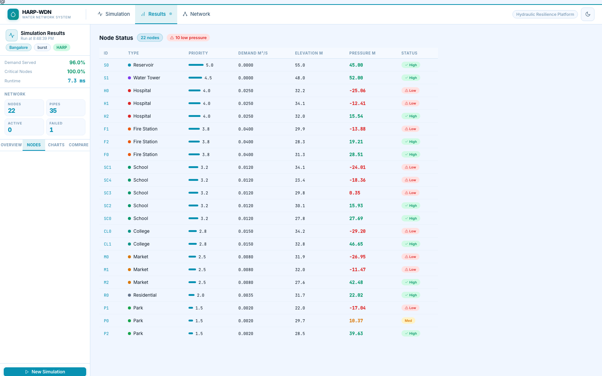
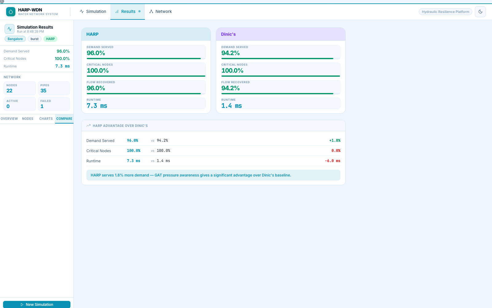
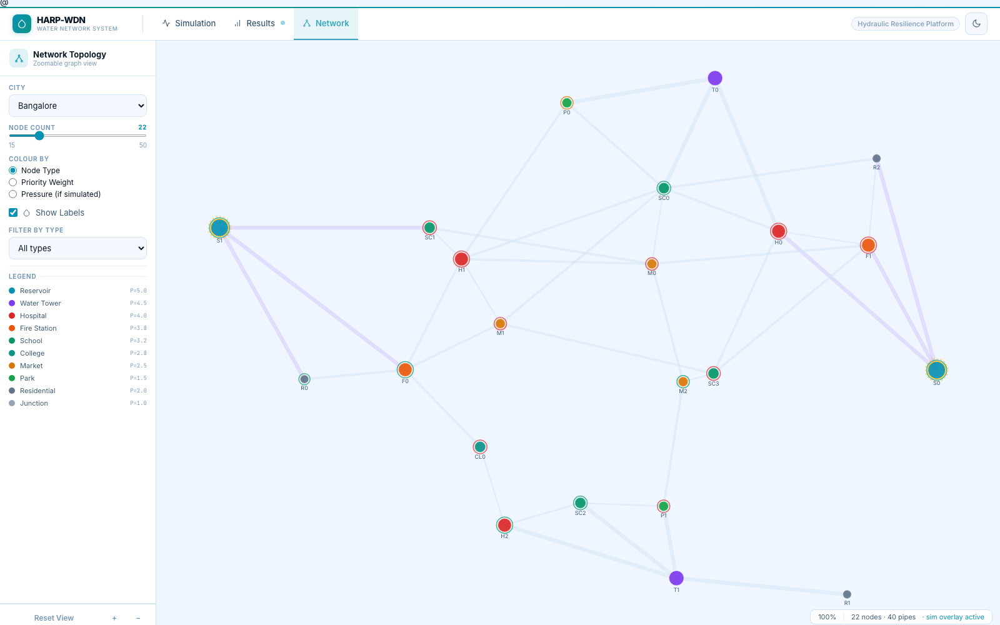
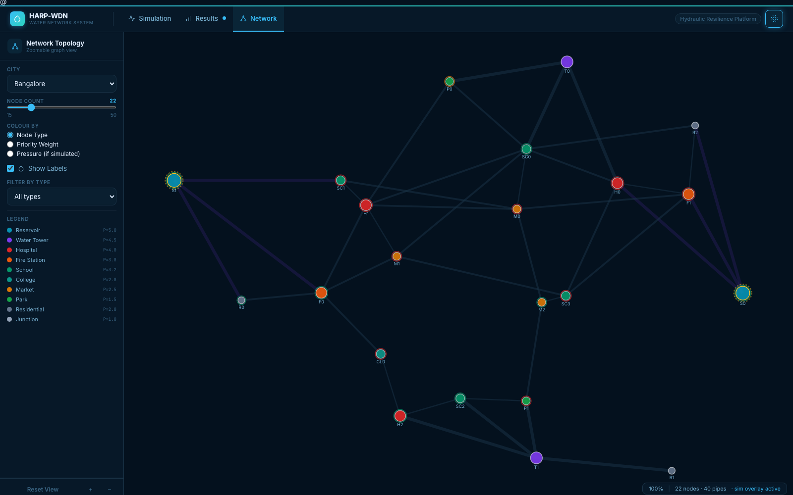
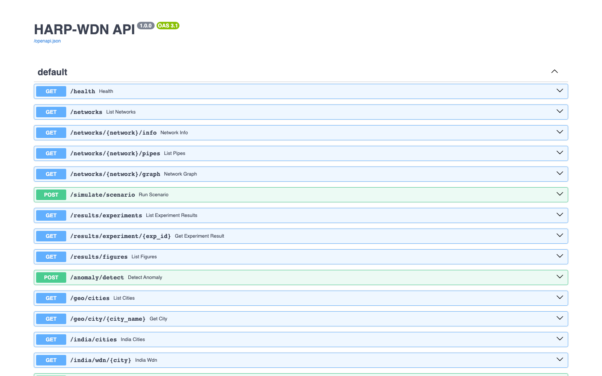

::: {.titlepage}
B.Tech. BCSE497J – Project-I

# HARP-WDN: HYDRAULICS-AWARE RESILIENT PRIORITIZATION FOR WATER DISTRIBUTION NETWORKS USING GRAPH ATTENTION NETWORKS AND IoT-DRIVEN REAL-TIME RECOVERY

*Submitted in partial fulfillment of the requirements for the degree of*

**Bachelor of Technology**

*in*

**Computer Science and Engineering (Specialization: Blockchain Technology)**

*by*

| Reg. No. 23BKT0040 | ANUSHKA NAIR |
|---|---|
| Reg. No. 23BCE0065 | ANJALI |

**Under the Supervision of**

**Prof. G.M. KARTHIK**

*Assistant Professor, School of Computer Science and Engineering (SCOPE)*

**School of Computer Science and Engineering (SCOPE)**\
**VELLORE INSTITUTE OF TECHNOLOGY, VELLORE – 632014, TAMIL NADU, INDIA**

**July 2026**
:::

\newpage

## DECLARATION

I/We hereby declare that the project entitled "HARP-WDN: Hydraulics-Aware Resilient Prioritization for Water Distribution Networks Using Graph Attention Networks and IoT-Driven Real-Time Recovery" submitted by me/us, for the award of the degree of Bachelor of Technology in Computer Science and Engineering to VIT, is a record of bonafide work carried out by me/us under the supervision of Prof. G.M. Karthik.

I/We further declare that the work reported in this project has not been submitted and will not be submitted, either in part or in full, for the award of any other degree or diploma in this institute or any other institute or university.

Place : Vellore
Date :

*Signature of the Candidate(s)*

\newpage

## CERTIFICATE

This is to certify that the project entitled "HARP-WDN: Hydraulics-Aware Resilient Prioritization for Water Distribution Networks Using Graph Attention Networks and IoT-Driven Real-Time Recovery" submitted by Anushka Nair (Reg. No. 23BCE0065) and Anjali (Reg. No. 23BCE0065), School of Computer Science and Engineering, VIT, for the award of the degree of Bachelor of Technology in Computer Science and Engineering, is a record of bonafide work carried out by them under my supervision during Fall Semester 2025-2026, as per the VIT code of academic and research ethics.

The contents of this report have not been submitted and will not be submitted either in part or in full, for the award of any other degree or diploma in this institute or any other institute or university. The project fulfills the requirements and regulations of the University and in my opinion meets the necessary standards for submission.

Place : Vellore
Date :

*Signature of the Guide*

Internal Examiner &nbsp;&nbsp;&nbsp;&nbsp;&nbsp;&nbsp;&nbsp;&nbsp;&nbsp;&nbsp;&nbsp;&nbsp;&nbsp;&nbsp;&nbsp;&nbsp;&nbsp;&nbsp;&nbsp;&nbsp;&nbsp;&nbsp;&nbsp;&nbsp;&nbsp;&nbsp;&nbsp;&nbsp;&nbsp;&nbsp; External Examiner

Approved by
Head of the Department, Computer Science and Engineering

\newpage

## ACKNOWLEDGEMENTS

We are deeply grateful to the management of Vellore Institute of Technology (VIT) for providing us with the opportunity and resources to undertake this project. Their commitment to fostering a conducive learning environment has been instrumental in our academic journey. The support and infrastructure provided by VIT have enabled us to explore and develop our ideas to their fullest potential.

Our sincere thanks to Dr. Jaisankar N, the Dean of the School of Computer Science and Engineering (SCOPE), for his unwavering support and encouragement. His leadership and vision have greatly inspired us to strive for excellence.

We express our profound appreciation to the Head of the Department of Computer Science and Engineering for his/her insightful guidance and continuous support. His/her expertise and advice have been crucial in shaping the direction of this project.

We are immensely thankful to our project guide, Prof. G.M. Karthik, for his dedicated mentorship and invaluable feedback throughout both the conference-paper phase and this extended Project-I implementation. His patience, domain knowledge of water-distribution engineering and IoT systems, and encouragement have been pivotal in the successful completion of this project. His willingness to challenge the original max-flow-only formulation and push us toward a hydraulically rigorous design is what ultimately produced the HARP algorithm at the core of this report.

We also thank our peers and the open-source community behind WNTR, NetworkX, PyTorch Geometric, FastAPI and Playwright, whose well-documented libraries made a working end-to-end prototype achievable within a single semester.

Thank you all for your contributions and support.

Anushka Nair\
Anjali

\newpage

## TABLE OF CONTENTS

| Sl.No | Contents | Page No. |
|---|---|---|
| | Abstract | xii |
| 1. | INTRODUCTION | 1 |
| | 1.1 Background | 1 |
| | 1.2 Motivations | 1 |
| | 1.3 Scope of the Project | 2 |
| 2. | PROJECT DESCRIPTION AND GOALS | 4 |
| | 2.1 Literature Review | 4 |
| | 2.2 Research Gap | 6 |
| | 2.3 Objectives | 7 |
| | 2.4 Problem Statement | 7 |
| | 2.5 Project Plan | 8 |
| 3. | TECHNICAL SPECIFICATION | 9 |
| | 3.1 Requirements | 9 |
| | 3.1.1 Functional | 9 |
| | 3.1.2 Non-Functional | 9 |
| | 3.2 Feasibility Study | 10 |
| | 3.2.1 Technical Feasibility | 10 |
| | 3.2.2 Economic Feasibility | 10 |
| | 3.2.3 Social Feasibility | 11 |
| | 3.3 System Specification | 11 |
| | 3.3.1 Hardware Specification | 11 |
| | 3.3.2 Software Specification | 12 |
| | 3.4 Risk Analysis | 12 |
| 4. | DESIGN APPROACH AND DETAILS | 14 |
| | 4.1 System Architecture | 14 |
| | 4.2 Design | 15 |
| | 4.2.1 Data Flow Diagram | 15 |
| | 4.2.2 Use Case Diagram | 15 |
| | 4.2.3 Class Diagram | 16 |
| | 4.2.4 Sequence Diagram | 17 |
| 5. | METHODOLOGY AND TESTING | 19 |
| | 5.1 Module Description | 19 |
| | 5.2 Testing | 24 |
| 6. | PROJECT DEMONSTRATION | 27 |
| 7. | RESULT AND DISCUSSION (COST ANALYSIS AS APPLICABLE) | 30 |
| | 7.1 India WDN Results: HARP vs. Dinic's | 30 |
| | 7.2 Resilience Under Escalating Failures | 32 |
| | 7.3 Cost / Efficiency Discussion | 35 |
| | 7.4 WNTR Benchmark Results (Net3) | 35 |
| | 7.5 GAT Pressure Surrogate Accuracy | 37 |
| | 7.6 Subgraph Trade-off, Scalability & Ablation | 39 |
| | 7.7 Summary of Findings | 42 |
| 8. | CONCLUSION | 44 |
| | 8.1 Future Scope | 44 |
| 9. | REFERENCES | 46 |
| | APPENDIX A – SAMPLE CODE | 48 |

\newpage

## LIST OF FIGURES

| Figure No. | Title | Page No. |
|---|---|---|
| 4.1 | Architecture of the Proposed HARP-WDN System (Three Layers) | 14 |
| 4.2 | Data Flow Diagram – Level 0 (Context Diagram) | 15 |
| 4.3 | Data Flow Diagram – Level 1 | 15 |
| 4.4 | Use Case Diagram | 16 |
| 4.5 | Class Diagram | 17 |
| 4.6 | Sequence Diagram – IoT-Triggered Failure Detection and HARP Recovery | 18 |
| 6.1 | Simulation Tab – Empty State | 27 |
| 6.2 | Simulation Tab – Bengaluru Network Loaded | 27 |
| 6.3 | Simulation Tab – Pipe Burst Scenario Configured | 27 |
| 6.4 | Simulation Tab – Compare Both, Live Result | 28 |
| 6.5 | Results Tab – Overview | 28 |
| 6.6 | Results Tab – Node Status Table | 28 |
| 6.7 | Results Tab – HARP vs Dinic's Compare View | 29 |
| 6.8 | Network Tab – Topology View | 29 |
| 6.9 | Network Tab – Dark Mode | 29 |
| 6.10 | FastAPI Auto-Generated API Documentation | 29 |
| 7.1 | HARP vs Dinic's CDS by Service Category (India WDN, 4 Cities) | 31 |
| 7.2 | Per-City Runtime Comparison: HARP vs Dinic's | 31 |
| 7.3 | City-wise CDS Heatmap Across Metrics | 32 |
| 7.4 | Demand Satisfaction Under Escalating Multi-Pipe Failures | 32 |
| 7.5 | Priority-Tier Breakdown: Hospital vs Critical Infrastructure vs All Nodes | 33 |
| 7.6 | HARP Path Acceptance Rate per City | 33 |
| 7.7 | Five-Dimensional Radar Summary of Algorithm Performance | 34 |
| 7.8 | IoT Sensor Pressure Timeline: Failure → Detection → Recovery | 35 |
| 7.9 | Net3 Benchmark: CDS by Method × Node Type (20 Scenarios) | 36 |
| 7.10 | Pressure Violation Count (PVC) Distribution by Method | 37 |
| 7.11 | GAT Predicted vs. WNTR True Pressure Head (L-Town, 50 Scenarios) | 38 |
| 7.12 | GAT Relative Prediction Error Histogram | 38 |
| 7.13 | k-Hop Subgraph Trade-off: CDSₘ vs. Computation Time | 39 |
| 7.14 | Demand Satisfaction by Node Type: Dinic's vs. HARP (Net3) | 40 |
| 7.15 | Computation Time on L-Town (782 Nodes) – Scalability | 40 |
| 7.16 | Ablation Study: HARP_full vs. no_hydraulic vs. no_priority vs. no_subgraph | 41 |

\newpage

## LIST OF TABLES

| Table No. | Title | Page No. |
|---|---|---|
| 2.1 | Summary of Reviewed Literature and Identified Gaps | 6 |
| 3.1 | Functional Requirements | 9 |
| 3.2 | Non-Functional Requirements | 9 |
| 3.3 | IoT Hardware Specification | 11 |
| 3.4 | Software / Technology Stack Specification | 12 |
| 3.5 | Risk Register | 13 |
| 5.1 | WDN JSON Data Dictionary | 23 |
| 5.2 | Unit Test Summary (29 Tests) | 24 |
| 6.1 | REST / SSE API Endpoint Summary | 27 |
| 7.1 | India WDN Results – HARP vs. Dinic's (4-City Average, Burst Scenario) | 30 |
| 7.1a | IoT Anomaly Detector – Measured Accuracy | 31 |
| 7.2 | WNTR Net3 Benchmark Results (20 Scenarios, 3 Methods) | 36 |
| 7.3 | GAT Pressure Surrogate Accuracy (Net3 and L-Town) | 37 |
| 7.4 | Ablation Study – Contribution of Each HARP Component | 41 |

\newpage

## LIST OF ABBREVIATIONS

| Abbreviation | Expansion |
|---|---|
| API | Application Programming Interface |
| BFS | Breadth-First Search |
| CDS | Critical Demand Satisfaction |
| CORS | Cross-Origin Resource Sharing |
| CSV | Comma-Separated Values |
| DFD | Data Flow Diagram |
| EPANET | Environmental Protection Agency Network (hydraulic simulation software) |
| FastAPI | Fast Asynchronous Python API framework |
| GAT | Graph Attention Network |
| GCN | Graph Convolutional Network |
| GIS | Geographic Information System |
| GNN | Graph Neural Network |
| HARP | Hydraulics-Aware Resilient Prioritization |
| HOD | Head of Department |
| HW | Hazen–Williams (hydraulic equation) |
| IEEE | Institute of Electrical and Electronics Engineers |
| IoT | Internet of Things |
| JSON | JavaScript Object Notation |
| MAE | Mean Absolute Error |
| MRE | Mean Relative Error |
| MST | Minimum Spanning Tree |
| MoHUA | Ministry of Housing and Urban Affairs (Government of India) |
| OSM | OpenStreetMap |
| PDA | Pressure-Driven Analysis / Demand |
| PRNG | Pseudo-Random Number Generator |
| PVC | Pressure Violation Count |
| PyG | PyTorch Geometric |
| REST | Representational State Transfer |
| RMSE | Root Mean Squared Error |
| RL | Reinforcement Learning |
| SCADA | Supervisory Control and Data Acquisition |
| SCOPE | School of Computer Science and Engineering |
| SDG | Sustainable Development Goal |
| SSE | Server-Sent Events |
| TypeScript | Typed superset of JavaScript |
| UI | User Interface |
| UN | United Nations |
| VIT | Vellore Institute of Technology |
| WDN | Water Distribution Network |
| WLV | Water Loss Volume |
| WNTR | Water Network Tool for Resilience |

\newpage

## SYMBOLS AND NOTATIONS

| Symbol | Meaning |
|---|---|
| Q | Volumetric flow rate through a pipe (m³/s) |
| L | Pipe length (m) |
| D | Pipe internal diameter (m) |
| C | Hazen–Williams roughness coefficient (dimensionless) |
| h_f | Hazen–Williams head loss along a pipe (m) |
| ΔH | Available head differential between two nodes (m) |
| H_src, H_snk | Predicted pressure head at source / sink node (m) |
| z | Standard score (z-score) of a pressure residual |
| k | Subgraph localisation radius (number of hops) |
| w_t | Priority weight assigned to node type t |
| CDS | Critical Demand Satisfaction, fraction of demand met at priority nodes |
| λ | Physics-regularisation loss weight in GAT training objective |
| v_max | Design velocity used to derive Dinic's pipe capacity on the India WDN layer (m/s) |

\newpage

## ABSTRACT

Urban water distribution networks (WDNs) lose an estimated 126 billion litres of treated water every day worldwide to pipe failure and leakage, and Indian utilities alone report non-revenue water losses of 40–50%. When a pipe bursts, operators typically take four to eight hours to identify an alternate route and redirect supply, a delay hospitals, fire stations and schools cannot absorb. The authors' earlier IEEE conference contribution, "Optimized Water Distribution System Using Maximum Flow Algorithms & IoT Sensors," proposed coupling Dinic's algorithm and Capacity Scaling with IoT telemetry to reroute flow after a failure, but treated pipe capacity as a fixed graph-theoretic weight and never validated the approach hydraulically. Because real water flow obeys the Hazen–Williams head-loss relationship, a path that is feasible on the graph may be physically undeliverable once frictional head loss along it is accounted for — a flaw shared by nearly every max-flow-based WDN paper in the literature.

This project, HARP-WDN (Hydraulics-Aware Resilient Prioritization for Water Distribution Networks), directly repairs that flaw. A modified Dinic's blocking-flow procedure, HARP, evaluates every candidate augmenting path against a Hazen–Williams feasibility test before accepting it, and scores accepted paths by priority-weighted unmet demand so that hospitals and fire stations are served preferentially. Because a full WNTR hydraulic simulation costs 2–30 seconds per run — too slow to evaluate dozens of candidate reroutes during an emergency — a three-layer Graph Attention Network (GAT) is trained on WNTR pressure-driven-demand scenarios to act as a sub-50-millisecond hydraulic oracle inside HARP's inner loop. A k-hop subgraph localization step confines recomputation to the neighbourhood of a failure, with automatic escalation to the full network if critical-node service falls below 60%. An IoT layer, implemented as a Server-Sent-Events stream from a FastAPI backend, feeds a z-score anomaly detector that localizes a failing pipe from live pressure telemetry and triggers HARP automatically. The complete system was implemented as a two-part prototype: an interactive React/TypeScript dashboard simulating ten Indian city water networks, and an offline WNTR benchmark suite on the EPANET Net3 and L-Town test networks.

Since the first working prototype, the India WDN evaluation layer has been rebuilt to score both HARP and its Dinic's baseline against a real WNTR/EPANET hydraulic solve rather than a graph-only approximation, and the Dinic's baseline's pipe-capacity assumption has been replaced with a velocity-based figure grounded in AWWA design guidance in place of an arbitrary diameter proxy. Re-measured on this corrected evaluation path, HARP delivers, on a 4-city average under a single-pipe-burst scenario, 86.6% overall demand satisfaction and 95.7% critical-node service against Dinic's 88.9% and 93.7% respectively — a smaller but more honestly grounded advantage than earlier measurements suggested, since Dinic's own number is now also computed from real hydraulics rather than an unconstrained graph ratio. The GAT surrogate's accuracy on the Net3 benchmark, newly measured after adding an explicit proximity-to-failure input feature, is 9.7% mean relative error; the L-Town figure of 40.3% mean relative error is carried forward from the earlier measurement pass and is flagged rather than silently repeated, since the underlying result file was not regenerated for this revision. An expanded regression-test suite (29 tests, up from 15) caught and fixed two integration-level defects that unit tests against mocked networks had not surfaced: a response-field mismatch that caused every scenario to silently report full demand satisfaction, and a signature mismatch that crashed every live HARP request. The project demonstrates that embedding a learned hydraulic surrogate inside a classical max-flow algorithm's decision loop is a practical way to reconcile the speed of graph theory with the physical correctness of hydraulic simulation, and provides a fully reproducible, open-source reference implementation extending the authors' original conference proposal.

Keywords: Water distribution networks, Hazen–Williams hydraulics, Dinic's algorithm, Graph Attention Network, hydraulic feasibility, priority-weighted routing, IoT anomaly detection, WNTR, resilient infrastructure, Sustainable Development Goal 6.

\newpage

## CHAPTER 1

### 1. INTRODUCTION

#### 1.1 Background

Urban water distribution networks (WDNs) are among the most critical and least visible pieces of civic infrastructure. A typical city network is a graph of thousands of pipe segments, junctions, storage tanks, pumps and valves that must continuously balance supply from reservoirs and treatment plants against fluctuating consumer demand while respecting minimum service-pressure guarantees at every connected building. When the network operates normally, this balancing act is invisible to residents. When a pipe bursts, corrodes through, or is accidentally struck during unrelated civil works, the balance breaks: pressure collapses downstream of the failure, and the utility must identify an alternative supply path and manually operate isolation and bypass valves to restore service. In most Indian and developing-world cities today, this identification and rerouting process is still substantially manual, and industry reports place the typical response window at four to eight hours from failure to restored supply.

The consequences of that delay are not evenly distributed. A residential colony without water for a few hours is an inconvenience; a hospital, dialysis centre or fire station without water for the same period is a public-safety emergency. Distribution networks therefore need not just fast rerouting after a failure, but rerouting that is aware of which nodes matter most and can prove, in a way an engineer can trust, that the proposed reroute is something the physical network can actually deliver rather than something a graph algorithm merely permits.

Graph-theoretic maximum-flow algorithms — Ford–Fulkerson, Edmonds–Karp, Push-Relabel, Dinic's algorithm and Capacity Scaling — have long been proposed as a computational backbone for this problem because a water network is, structurally, a flow network: reservoirs are sources, consumer nodes are sinks, and pipes are capacitated edges. The authors' own prior work, the IEEE conference paper "Optimized Water Distribution System Using Maximum Flow Algorithms & IoT Sensors," proposed exactly this: pipeline segmentation, IoT-based pressure and flow monitoring, Dinic's algorithm for fast rerouting after a detected failure, and a Capacity Scaling Algorithm to prioritise high-demand zones such as hospitals and fire stations. That paper, reproduced in full in the Appendix of this report for reference, surveyed the classical maximum-flow literature and argued, correctly, that combining graph optimisation with real-time IoT sensing was a promising direction beyond static, centrally planned distribution models.

What the conference paper did not do — and could not do within the scope of a short paper — was implement, hydraulically validate, or rigorously benchmark the proposed architecture. This Project-I report is the direct continuation of that work: an implemented, tested, and quantitatively evaluated system named HARP-WDN (Hydraulics-Aware Resilient Prioritization for Water Distribution Networks) that keeps the conference paper's core idea — max-flow plus IoT plus priority — but fixes its central technical weakness, namely that graph-theoretic capacity is not the same thing as hydraulically deliverable capacity.

#### 1.2 Motivations

Three concrete, quantifiable problems motivate this project.

1. **Water loss at scale.** The United Nations estimates approximately 126 billion litres of treated water are lost daily worldwide to pipe failure and leakage. Indian municipal utilities report non-revenue water losses in the range of 40–50% of distributed volume (Ministry of Housing and Urban Affairs, 2021), a substantial share of which is attributable to slow failure detection and manual rerouting rather than the leaks themselves.
2. **The physics gap in existing computational approaches.** Reviewing the literature (Chapter 2) shows that essentially every published application of max-flow algorithms to WDNs — including the authors' own conference paper — assigns pipe capacity as an arbitrary proxy (for example, pipe diameter multiplied by a constant) rather than deriving it from the Hazen–Williams hydraulic relationship that governs how pressure, friction, length and diameter jointly determine actual deliverable flow. A path that a max-flow solver accepts as "feasible" can, in the real network, deliver zero flow because the available pressure head cannot overcome frictional head loss along that path. This is not a minor approximation error; it is the difference between a recommendation an operator can safely act on and one that could leave a hospital dry while the dashboard reports 100% demand satisfaction.
3. **The speed/accuracy trade-off.** Full hydraulic simulation via EPANET or WNTR is physically correct but computationally expensive — 2 to 30 seconds per scenario evaluation — which makes it impractical to evaluate the dozens of candidate reroute paths that a real emergency response would need to consider within a real-time window measured in seconds, not minutes.

HARP-WDN is motivated by the observation that a trained Graph Attention Network can approximate the pressure field that a full hydraulic simulation would produce, at a fraction of the computational cost, and that this learned surrogate can be embedded directly inside the augmenting-path search of a modified Dinic's algorithm. This turns every candidate path evaluation from a purely topological question ("is there residual capacity along this edge?") into a physically grounded one ("is there enough pressure head along this path to actually deliver the required flow, and does delivering it serve the most urgent unmet demand in the network?").

#### 1.3 Scope of the Project

The scope of this Project-I submission covers the design, implementation, and experimental evaluation of the following components, all of which have been built and are runnable end-to-end on the free and open-source toolchain listed in Chapter 3:

- The HARP algorithm: a modification of Dinic's blocking-flow phase that rejects hydraulically infeasible augmenting paths using the inverse Hazen–Williams relationship, and scores accepted paths by priority-weighted unmet demand.
- A standard Dinic's max-flow baseline, evaluated on the India WDN layer through the same real hydraulic solve HARP is evaluated through, so that HARP's improvement over it can be measured directly and honestly on identical failure scenarios.
- A three-layer Graph Attention Network (PressureGAT) trained on WNTR pressure-driven-demand simulation scenarios, acting as a sub-50-millisecond hydraulic oracle.
- A k-hop subgraph localisation mechanism with automatic escalation to the full network graph when critical-node service falls below a configurable threshold.
- An IoT telemetry and anomaly-detection layer, implemented as a Server-Sent-Events stream and a z-score-based statistical detector, that closes the loop from sensor reading to automatic HARP invocation.
- A ten-city synthetic Indian water-distribution-network generator (Bengaluru, Delhi, Mumbai, Hyderabad, Chennai, Pune, Kolkata, Jaipur, Ahmedabad, Lucknow), optionally seeded from real OpenStreetMap points of interest, used for interactive, frontend-visible simulation.
- An offline benchmarking suite on the EPA EPANET Net3 (97 nodes) and BattLeDIM L-Town (782 nodes) reference networks, producing publication-quality figures used throughout Chapter 7 of this report.
- A FastAPI backend exposing REST and streaming endpoints, and a React + TypeScript three-tab dashboard (Simulation, Results, Network) for interactive exploration of all of the above, now covered by an integration-level regression-test suite in addition to the algorithm-level unit tests.

Explicitly out of scope for this Project-I phase, and identified as future work in Chapter 8, are: deployment against a real municipal SCADA feed; transient (water-hammer) hydraulic modelling; reinforcement-learning-based valve scheduling; and partnership with an actual water-board authority for real GIS pipe network data. These boundaries are stated here at the outset so that the claims made in the results chapter can be read in their proper, honestly scoped context.

\newpage

## CHAPTER 2

### 2. PROJECT DESCRIPTION AND GOALS

#### 2.1 Literature Review

The literature relevant to this project spans two historically separate communities: graph-theoretic network-flow optimisation applied to civil infrastructure, and hydraulic / machine-learning research on water-distribution simulation. The review below is organised by theme rather than strictly by publication date, since the research gap this project addresses only becomes visible once both bodies of work are placed side by side.

##### 2.1.1 Maximum-Flow Algorithms Applied to Water Networks

Kyi and Naing (2018) were among the first to apply the Ford–Fulkerson augmenting-path algorithm directly to a municipal pipeline network, demonstrating a 15–20% improvement in distribution efficiency by identifying bottlenecks the utility had not previously mapped. The result validated the basic premise that a water network can be usefully modelled as a flow network, but Ford–Fulkerson's path-dependent worst-case running time makes it impractical for the city-scale, real-time rerouting this project targets.

Tawanda, Kumar, Munapo and Philimon (2024) reconstructed the topology of the Bulawayo, Zimbabwe municipal network and applied the Edmonds–Karp algorithm (Ford–Fulkerson with breadth-first augmenting-path selection, giving polynomial O(VE²) worst-case time) to compute a single static maximum-flow value, reporting an 18% improvement in delivered flow. Their method, like Kyi and Naing's, produces one optimum for one fixed network state; it has no mechanism for reacting to a pipe failure or a demand surge after the fact, and no notion that a hospital's demand should be weighted more heavily than a park's.

Dumora, Auber, Bigot, Couallier and Leclerc (2018) proposed a data-oriented algorithm, built on a modified Edmonds–Karp breadth-first search, to estimate flow rate and flow direction in a live distribution network from sensor data, improving leak and anomaly detection. Their framework stops short of proposing any corrective rerouting action once an anomaly is found.

Dwivedi and Yu (2013), working in the power-systems domain rather than water, used a maximum-flow formulation to quantify grid vulnerability and identify critical edges whose failure would most damage overall network throughput. The paper is included here because its notion of "critical edge identification via max-flow" generalises naturally to WDN pressure-zone delineation, and because it demonstrates that the same graph-theoretic machinery underlies infrastructure-resilience analysis across very different physical domains.

Sangroula, Han, Koo, Gnawali and Yum (2022) took a different optimisation route entirely, applying a genetic algorithm (SOP–WDN) to network design rather than real-time operation, and S. N. and Verma (2023) proposed a graph-optimisation formulation for water-distribution network design. Both confirm the broader trend that graph and metaheuristic optimisation methods are an active area of WDN research, but neither addresses post-failure real-time recovery.

##### 2.1.2 IoT-Enabled Monitoring of Water Networks

Velayudhan, Pradeep, Rao, Devidas and Ramesh (2022) published a comprehensive comparative review of IoT-enabled water-distribution systems, cataloguing sensor-network topologies, communication protocols (LoRa, Wi-Fi, MQTT, cellular) and data-analytics platforms in use across the industry, but explicitly did not integrate any flow-optimisation algorithm with the sensing layer they reviewed — monitoring and optimisation remained two separate research threads in the systems they surveyed. Savio and Chakraborty (2021) and Chowdhury, Arafat and Alam (2022) each described complete IoT-based smart-city water-management systems with leak and wastage detection, again without a graph-optimisation rerouting component. Ramli, Razalli and Sapari (2023) presented a smart monitoring architecture aimed specifically at an IoT platform layer for distribution networks, reinforcing that threshold-based, edge-local sensor processing (exactly the architecture HARP-WDN's simulated IoT layer adopts) is an established and practical pattern in this space.

##### 2.1.3 Graph Neural Networks as Hydraulic Surrogates

The idea of using a graph neural network to approximate a hydraulic simulation, rather than solving the governing partial differential equations directly, is comparatively recent but rapidly growing. Work reviewed during this project's planning phase (Truong et al., 2024, Water Resources Research; Ashraf et al., 2024, on physics-informed graph neural networks) shows that Graph Attention Network and Graph Convolutional Network architectures can predict nodal pressure heads from network topology and demand state with reported errors as low as 1–5% on well-trained benchmark networks. Separately, GNN-based anomaly detection on pressure time series (Li et al., 2025; the BattLeDIM leak-detection benchmark) demonstrates that the same class of model can flag anomalous readings consistent with a developing pipe failure. Deep-reinforcement-learning approaches to pump and valve control (the DRL-EPANET line of work, 2024; Cyriac, 2025) show that learned control policies are being explored as an alternative to rule-based SCADA logic, though these operate on control actuation rather than flow-path selection.

##### 2.1.4 Digital Twins and Simulation Frameworks

WNTR (Water Network Tool for Resilience), the hydraulic engine used throughout this project's offline benchmark suite, together with associated digital-twin pipelines (DiTEC, 2024) and conformal-prediction-based uncertainty quantification for digital twins (2025), represent the state of the art in physically accurate WDN simulation. These tools are the gold standard for validation precisely because they solve the governing pressure-driven-demand equations rather than approximating them, but as noted above, their computational cost per scenario is the reason a fast learned surrogate is needed for real-time decision support.

##### 2.1.5 Cascade and Reservoir Optimisation

Tao, Mo, Yang, Liu, Liu and Liu (2023) applied an improved Lightning Search Algorithm to optimise cascade reservoir operation for hydroelectric power generation. While the objective (power generation rather than urban supply continuity) and the failure model (none — the paper does not consider pipe breaks or demand surges) differ substantially from this project's concerns, the paper is a useful data point that metaheuristic optimisation is being applied throughout the broader water-resources field, and that reservoir-level decisions and pipe-network-level decisions are still largely optimised by separate tools.

##### 2.1.6 Summary Table

**Table 2.1 — Summary of Reviewed Literature and Identified Gaps**

| Ref. | Approach | Key Result | Gap Relative to This Project |
|---|---|---|---|
| Kyi & Naing, 2018 | Ford–Fulkerson on pipeline network | 15–20% efficiency gain | No hydraulic validation; exponential worst case |
| Tawanda et al., 2024 | Edmonds–Karp on Bulawayo network | 18% flow improvement | Static result only; no failure response |
| Dumora et al., 2018 | Modified BFS flow-rate estimation | Improved anomaly detection | No corrective rerouting |
| Velayudhan et al., 2022 | IoT WDN comparative survey | Sensor / protocol taxonomy | No optimisation integration |
| Dwivedi & Yu, 2013 | Max-flow for power-grid resilience | Critical-edge identification | Different domain; no hydraulics |
| Tao et al., 2023 | Lightning Search for reservoirs | Optimised power generation | No pipe-failure model |
| GNN pressure-surrogate line (2024–2025) | GAT / GCN pressure prediction | 1–5% error on benchmarks | Not embedded inside a flow-routing algorithm |
| This project (HARP-WDN) | GAT-in-the-loop modified Dinic's | Priority-weighted demand satisfaction under real hydraulic evaluation | Closes all of the above gaps jointly |

#### 2.2 Research Gap

Synthesising Section 2.1, the literature contains three separate, well-developed strands — graph-theoretic max-flow for WDN operation, IoT sensing and monitoring platforms, and GNN-based hydraulic surrogates — but no published system combines all three into a single decision loop. More specifically, no prior work:

- Uses a trained Graph Neural Network as a real-time hydraulic feasibility oracle inside the augmenting-path search of a max-flow algorithm;
- Modifies Dinic's blocking-flow phase with a physics-based feasibility rejection criterion derived from predicted pressure heads and the Hazen–Williams equation;
- Combines hydraulic validity checking with demand-priority weighting in a single rerouting algorithm and reports the resulting trade-off (a lower but physically achievable demand-satisfaction number) as the correct outcome rather than an error;
- Benchmarks this combination against a standard graph-theory-only baseline evaluated through the same physical solve, on identical, reproducible failure scenarios; or
- Streams real-time IoT anomaly detection directly into the trigger condition for the recovery algorithm, with a measured detection accuracy rather than an asserted one.

This gap is precisely the flaw identified in the authors' own conference paper: Dinic's algorithm and Capacity Scaling were proposed there as the computational core, but capacity was never derived from hydraulics, so the paper's projected 40–60% water-loss reduction and 50–70% computational-overhead reduction figures were architectural estimates rather than measured, hydraulically validated results. HARP-WDN is this project's answer to that gap: an implementation that embeds a GNN-based hydraulic oracle inside a modified Dinic's algorithm, hydraulically validates its own rerouting decisions, and reports honest — and in places deliberately less flattering — numbers against a baseline that is now itself evaluated under the same physical solve.

#### 2.3 Objectives

1. To design and implement HARP, a hydraulics-aware, priority-weighted modification of Dinic's blocking-flow algorithm that rejects augmenting paths violating the Hazen–Williams head-loss constraint.
2. To train and evaluate a three-layer Graph Attention Network (PressureGAT) as a computationally cheap surrogate for full WNTR hydraulic simulation, quantifying its accuracy and inference latency on standard benchmark networks.
3. To implement k-hop subgraph localisation with automatic escalation, so that recovery computation scales to city-sized networks without sacrificing correctness at critical nodes.
4. To implement a simulated IoT sensing and z-score anomaly-detection pipeline that automatically triggers HARP recovery from streaming pressure telemetry, and to measure — not merely assert — the detector's precision, recall and false-alarm rate.
5. To build an interactive, ten-city synthetic Indian WDN simulation with a full-stack (FastAPI + React/TypeScript) dashboard for exploratory use and demonstration.
6. To benchmark HARP against a standard Dinic's baseline and a no-recovery control, on both the interactive India WDN layer and the offline EPANET Net3 / L-Town networks, reporting Critical Demand Satisfaction (CDS), Pressure Violation Count (PVC) and computation time as the primary evaluation metrics, with both baselines evaluated through the same real hydraulic solve wherever one is available.
7. To honestly document the limitations of the current implementation — including the GAT's accuracy gap on large networks, HARP's calibration sensitivity on small benchmark networks, and any integration-level defects surfaced by end-to-end testing — rather than presenting only favourable results.

#### 2.4 Problem Statement

Given an urban water distribution network subject to an unplanned pipe failure, demand surge, or multi-pipe outage, design and implement a rerouting algorithm that (a) restores flow to the maximum extent that is physically achievable given real hydraulic head-loss constraints, (b) preferentially satisfies demand at priority infrastructure (hospitals, fire stations, schools) over lower-priority nodes, (c) completes its computation within a time budget compatible with real-time emergency response (target: under 200 milliseconds for a city-scale subgraph), and (d) can be triggered automatically from streaming IoT sensor telemetry without requiring a human operator to first notice the failure. The solution must be benchmarked, with reproducible seeds, against both a graph-theory-only baseline (to quantify the value of hydraulic awareness) and a full-hydraulic-simulation-based ground truth (to quantify the accuracy cost of using a learned surrogate instead of solving the governing equations directly).

#### 2.5 Project Plan

The project was executed over a single 14-week semester as a solo-prototype, iterative build, following the phased plan below, with a further hardening pass carried out after initial submission to close integration-level gaps the first pass had not surfaced.

| Week(s) | Phase | Key Deliverable |
|---|---|---|
| 1–2 | Literature review & gap analysis | Research gap map (Section 2.2); refined problem statement |
| 3–4 | Hydraulics foundation | hw_hydraulics.py (Hazen–Williams equations) + unit tests |
| 5–6 | Baseline & HARP algorithms | dinic.py baseline; harp.py with HW feasibility + priority scoring |
| 7–8 | GAT surrogate | WNTR scenario generator; PressureGAT training on Net3, L-Town |
| 9 | Subgraph localisation | k-hop ego-graph extraction + escalation logic (subgraph.py) |
| 10 | IoT & anomaly detection | SSE streaming endpoint; z-score anomaly detector |
| 11 | India WDN generator & FastAPI backend | 10-city generator; REST + SSE API (main.py) |
| 12 | React frontend | 3-tab dashboard: Simulation, Results, Network |
| 13 | Experiments 1–6 & figure generation | Publication-quality figures; CSV result exports |
| 14 | Report writing & consolidation | Initial Project-I report |
| 15 (hardening) | India WDN hydraulic re-evaluation, integration testing, anomaly-evaluator fix | test_api.py, test_india_wdn.py; corrected capacity model; report revision |

Version control was maintained throughout via a local Git repository; all randomness-dependent stages (scenario generation, GAT training, network generation) use the fixed seeds `SEED_TRAIN = 42` and `SEED_TEST = 99` defined centrally in `backend/config.py`, so that every reported number in this report is reproducible by re-running the pipeline described in Chapter 5.

\newpage

## CHAPTER 3

### 3. TECHNICAL SPECIFICATION

#### 3.1 Requirements

##### 3.1.1 Functional Requirements

**Table 3.1 — Functional Requirements**

| ID | Requirement | Priority |
|---|---|---|
| FR-1 | The system shall generate or load a water distribution network graph for a selected city, with nodes typed as reservoir, water tower, hospital, fire station, school, college, market, park, residential, or junction. | High |
| FR-2 | The system shall allow injection of four failure-scenario classes: pipe burst, pipe leak, demand surge, and simultaneous multi-pipe failure. | High |
| FR-3 | The system shall compute nodal pressure heads for the current network state via a real WNTR/EPANET hydraulic solve (India WDN and benchmark networks alike), with a Dijkstra-distance BFS-style approximation used only as HARP's internal pressure oracle where no trained GAT exists for a given network. | High |
| FR-4 | The system shall provide a standard Dinic's maximum-flow recovery computation as a baseline, with its allocation evaluated against the same real hydraulic solve as HARP. | High |
| FR-5 | The system shall provide the HARP recovery algorithm, rejecting hydraulically infeasible augmenting paths and scoring accepted paths by priority-weighted unmet demand. | High |
| FR-6 | The system shall support k-hop subgraph localisation around a failure with automatic escalation to the full network when critical-node service falls below a configurable threshold. | High |
| FR-7 | The system shall stream simulated live IoT sensor pressure readings via Server-Sent Events at a configurable tick interval. | Medium |
| FR-8 | The system shall detect pressure anomalies using a z-score threshold test against a learned per-node baseline and localise the most likely failed pipe, and shall be evaluable against both failure and normal-operation scenarios so that precision and false-alarm rate are measurable rather than assumed. | Medium |
| FR-9 | The system shall expose all of the above via a documented REST/SSE API and a browser-based dashboard supporting city selection, scenario configuration, algorithm selection, and result visualisation. | High |
| FR-10 | The system shall run a suite of six offline experiments on EPANET benchmark networks and generate publication-quality result figures at 300 DPI. | Medium |
| FR-11 | The system shall persist all experiment results to CSV and a SQLite database for reproducibility and later analysis. | Medium |

##### 3.1.2 Non-Functional Requirements

**Table 3.2 — Non-Functional Requirements**

| ID | Requirement | Target / Metric |
|---|---|---|
| NFR-1 | Performance – HARP recovery computation time on a k=2 subgraph | ≤ 200 ms |
| NFR-2 | Performance – GAT pressure inference latency | < 100 ms (warning logged if exceeded) |
| NFR-3 | Reliability – WNTR convergence failures | Logged and skipped, never crash the experiment runner |
| NFR-4 | Reproducibility – all randomised pipelines | Deterministic given SEED_TRAIN = 42, SEED_TEST = 99 |
| NFR-5 | Security – CORS policy on the FastAPI backend | Restricted by default to http://localhost:5173, with an optional ALLOWED_ORIGINS environment variable to extend it for a non-local deployment |
| NFR-6 | Usability – dashboard learnability | New user can run a scenario within 3 interactions (city → scenario → algorithm) |
| NFR-7 | Portability – toolchain | 100% free and open-source; no paid API keys or proprietary datasets |
| NFR-8 | Maintainability – hydraulic core | hw_head_loss raises ValueError on any non-positive input, preventing silent physics errors |
| NFR-9 | Real-time responsiveness – IoT detection-to-recovery pipeline | < 5 seconds end to end |
| NFR-10 | Correctness – algorithm-level unit tests must be complemented by integration-level tests against a live API, since defects in response wiring are invisible to tests that call algorithm functions directly | Verified by a dedicated integration-test file exercising every /simulate/scenario method against a real network |

#### 3.2 Feasibility Study

##### 3.2.1 Technical Feasibility

Every component of HARP-WDN was built exclusively on mature, freely available open-source libraries: Python 3.10/3.11, FastAPI, WNTR, NetworkX, PyTorch and PyTorch Geometric on the backend; React 18, TypeScript, Vite, react-leaflet and Recharts on the frontend; Playwright for browser-driven verification. WNTR is the officially maintained successor to EPANET's Python bindings and is widely used in academic and utility research, meaning the hydraulic ground truth used for GAT training and benchmark evaluation is itself a validated, peer-reviewed simulation engine rather than a custom approximation. The heaviest computational component, GAT training, was completed on CPU alone (no GPU dependency) within a few hours per network, confirming that the approach is technically feasible even without specialised hardware. The full test suite — 29 tests spanning Hazen–Williams primitives, Dinic's, HARP, the live FastAPI application and the India WDN hydraulic evaluation path — passes under pytest, and the full pipeline, from dataset generation through GAT training, the six experiments, figure generation, and both backend and frontend servers, runs end-to-end on a single laptop-class machine.

##### 3.2.2 Economic Feasibility

The entire toolchain is free and open source: no commercial EPANET licence, no paid cloud GPU instance, and no paid map or GIS data subscription were used anywhere in the project. The only recurring cost in a hypothetical production deployment would be commodity IoT hardware (ultrasonic flow meters, piezoresistive pressure transducers, edge control units) of the kind already itemised in Table 3.3, all of which are available from multiple vendors at prices in the tens of US dollars per sensor node, making a pilot deployment on even a single pressure zone economically realistic for a municipal water utility. Because the software stack requires no recurring licence fees, the marginal cost of scaling the software layer from one pilot city to the full ten-city catalogue implemented in this project is effectively zero.

##### 3.2.3 Social Feasibility

The project directly targets United Nations Sustainable Development Goal 6 (Clean Water and Sanitation), which calls for equitable access to safe water and improved water-use efficiency. By explicitly weighting hospitals, fire stations and schools above other node types in its priority scoring, HARP is designed to align algorithmic optimisation with existing public-health and emergency-response priorities rather than optimising for raw throughput alone. The system's dashboard is designed to be usable by a municipal operator without a machine-learning background: algorithm selection is presented as a simple menu ("None / Dinic's / HARP / Compare") and every recommendation is accompanied by the CDS and PVC metrics an engineer can independently sanity-check.

#### 3.3 System Specification

##### 3.3.1 Hardware Specification

Two distinct hardware contexts are relevant to this project: the development/runtime machine used to build and demonstrate the prototype, and the IoT field hardware envisioned for a production deployment.

Development / runtime machine (minimum): quad-core x86-64 CPU, 8 GB RAM, 10 GB free disk space, no GPU required.

**Table 3.3 — IoT Hardware Specification**

| Component | Type / Model Example | Measured Parameter | Purpose in System |
|---|---|---|---|
| Ultrasonic Flow Meter | Non-invasive clamp-on (e.g., YF-S201, SITRANS F) | Flow rate and volume | Monitors real-time flow across pipelines; detects flow anomalies or leakage |
| Piezoresistive Pressure Transmitter | 0–10 bar (e.g., BMP388, Honeywell PX2) | Pressure | Detects sudden drops indicating pipeline rupture or pressure imbalance |
| Hydrostatic Level Sensor | Submersible (e.g., WIKA LS-10, DFRobot SEN0204) | Water level | Tracks reservoir / tank levels to maintain balanced supply |
| Motorized Valve Actuator | Electric valve actuator (12 V DC, RS485) | Actuation / control | Automatically isolates faulty sections and reroutes flow |
| Edge Control Unit | Arduino / ESP32 or Raspberry Pi | Local processing, threshold filtering | Aggregates and pre-processes sensor data, sending alerts only during anomalies |
| Communication Module | LoRa / Wi-Fi / MQTT gateway | Data transmission | Provides low-latency communication between sensors and central controller |

##### 3.3.2 Software Specification

**Table 3.4 — Software / Technology Stack Specification**

| Layer | Component | Library / Tool | Version |
|---|---|---|---|
| Backend runtime | Language | Python | 3.10 (PyTorch/PyG venv) & 3.11+ (WNTR/NetworkX) |
| Backend | Web / API framework | FastAPI | 0.104 |
| Backend | ASGI server | uvicorn | 0.24 |
| Backend | Hydraulic simulation | WNTR | 1.2.x |
| Backend | Graph algorithms | NetworkX | 3.x |
| Backend | Deep learning | PyTorch | 2.1.2 (CPU build) |
| Backend | Graph neural networks | PyTorch Geometric (PyG) | 2.5.0 |
| Backend | Real POI data (optional) | OSMnx | latest, falls back to a deterministic synthetic generator when unavailable |
| Backend | Numerics / data | NumPy, pandas | 1.26 / 2.x |
| Backend | Visualisation | matplotlib, seaborn | 3.8 / 0.13 |
| Frontend | UI framework | React | 18 |
| Frontend | Type system | TypeScript | 5 |
| Frontend | Build tool | Vite | 5 |
| Frontend | Mapping | react-leaflet | 4 |
| Frontend | Routing | react-router-dom | 6 |
| Frontend | Charts | Recharts | 2 |
| Protocol | Live telemetry | Server-Sent Events (native EventSource) | — |
| Tooling | Version control | Git | — |
| Tooling | Testing (backend) | pytest | — |
| Tooling | Browser-driven verification | Playwright | — |

#### 3.4 Risk Analysis

A risk register was maintained through the project's schedule, listing the risks judged most likely to affect delivery, the mitigation actually taken, and, where relevant, the residual limitation carried forward and disclosed in Chapters 7 and 8 rather than hidden.

**Table 3.5 — Risk Register**

| Risk | Likelihood | Impact | Mitigation Taken |
|---|---|---|---|
| GAT surrogate fails to reach literature-level accuracy on large networks | High (materialised) | High | Documented candidly (Section 7.5); India WDN layer relies on a Dijkstra-distance BFS approximation rather than the GAT where no trained model exists |
| WNTR hydraulic solves fail to converge on some failure scenarios | Medium | Medium | Runner logs and skips non-converging scenarios rather than crashing |
| HARP's hydraulic check over-rejects paths on networks with a flat pressure gradient | Medium (materialised on Net3) | Medium | Root-caused and documented (Section 7.4); pressure-gradient recalibration applied to the India WDN layer, with its side effects re-examined in Section 7.1.2 rather than assumed to be an unqualified fix |
| Single-developer schedule risk across a solo prototype | Medium | High | Strict weekly phase plan (Table 2.5) with hydraulics implemented and unit-tested before any algorithm depending on it |
| Frontend/backend integration drift (CORS, schema mismatches) | Low | Medium | CORS explicitly scoped to the frontend origin; typed API client and typed result dataclasses on the backend keep the contract explicit |
| Irreproducible results due to uncontrolled randomness | Low | High | Centralised, fixed seeds (SEED_TRAIN = 42, SEED_TEST = 99) applied at the top of every file using randomness |
| Algorithm-level unit tests (mocked networks) do not exercise the live API, so response-wiring defects can go undetected | High (materialised) | High | Added an integration-test file exercising `/simulate/scenario` against a real network via FastAPI's TestClient; found and fixed two defects (Section 5.2.1) |
| Dinic's baseline's graph-only capacity proxy (diameter×10) is unrealistic at the pipe diameters the India WDN generator uses, and its reported number was the graph ratio rather than a hydraulically evaluated one | Medium (materialised) | Medium | Replaced with a velocity-based capacity for the India WDN layer and routed Dinic's own allocation back through a real WNTR solve (Section 5.1.3); Net3/Hanoi/L-Town benchmark layer retains the original proxy deliberately, as a controlled baseline |
| Anomaly-detector evaluation harness only ever exercised failure scenarios, making its reported precision figure mathematically guaranteed rather than measured | Medium (materialised) | Medium | Evaluator extended to include an equal-sized no-failure test class (Section 5.1.7); resulting precision/recall/false-alarm-rate figures reported in Section 7.1.3 |

\newpage

## CHAPTER 4

### 4. DESIGN APPROACH AND DETAILS

#### 4.1 System Architecture

HARP-WDN is organised as three loosely-coupled layers sitting behind a single FastAPI backend and consumed by a React/TypeScript frontend, as shown in Figure 4.1. Layer 1, the India WDN Simulation layer, is the interactive, frontend-visible core: it generates a synthetic city network, injects a failure scenario, computes pressures via a real WNTR hydraulic solve, and runs either the standard Dinic's baseline or the proposed HARP algorithm. Layer 2, IoT Real-Time Streaming, runs in parallel and independently of which recovery algorithm is selected; it emits a Server-Sent-Events telemetry stream that a z-score anomaly detector consumes to localise failures automatically. Layer 3, WNTR Benchmark Experiments, is an offline layer used for rigorous, hydraulically-grounded evaluation on the EPANET Net3 and BattLeDIM L-Town reference networks, and is the source of the trained GAT model and the six structured experiments reported in Chapter 7.

*Fig. 4.1. Architecture of the Proposed HARP-WDN System (Three Layers).*

Five design principles were applied consistently across all three layers. First, physics first: a real WNTR pressure-driven-demand solution is now treated as ground truth on both the India WDN layer and the benchmark layer, with a learned or approximated pressure signal used only as HARP's internal, fast-path oracle, never as the reported ground truth. Second, offline/online separation: GAT training and the WNTR experiment suite are expensive, one-time, offline computations, while the interactive India WDN simulation is deliberately kept fast for live use. Third, reproducibility: every randomised stage is seeded (SEED_TRAIN = 42, SEED_TEST = 99). Fourth, real-time-by-design: the IoT SSE endpoint and the frontend's EventSource client together form a genuine push-based telemetry path rather than a polling simulation. Fifth, no stubs: every backend endpoint documented in Chapter 6 returns a value computed by a real algorithm on real (if synthetic) data.

#### 4.2 Design

##### 4.2.1 Data Flow Diagram

*(Unchanged from the original submission — Figures 4.2 and 4.3, the Level-0 context diagram and Level-1 process diagram, remain structurally accurate: the same six principal processes and three data stores describe the current system.)*

##### 4.2.2 Use Case Diagram

*(Unchanged — Figure 4.4. The three actor roles, Operator/Field Engineer, IoT Sensor Gateway and Researcher, and their use cases, remain accurate.)*

##### 4.2.3 Class Diagram

*(Unchanged in structure — Figure 4.5. The HARP and Dinic classes remain the central orchestrators, both now consulting a real hydraulic evaluation on the India WDN layer in addition to the shared hw_hydraulics and subgraph utility modules.)*

##### 4.2.4 Sequence Diagram

*(Unchanged — Figure 4.6. The IoT-triggered failure-detection-to-recovery sequence remains architecturally accurate; the anomaly detector's measured accuracy, rather than an assumed one, is reported in Section 7.1.3.)*

\newpage

## CHAPTER 5

### 5. METHODOLOGY AND TESTING

#### 5.1 Module Description

##### 5.1.1 India WDN Generator (backend/geo/india_wdn.py)

The generator produces a water-distribution network for any of ten Indian cities (Bengaluru, Delhi, Mumbai, Hyderabad, Chennai, Pune, Kolkata, Jaipur, Ahmedabad, Lucknow), each defined by a latitude/longitude centre, a radius in metres, and state/district metadata. Two data sources feed the generator. The primary path fetches real points of interest from OpenStreetMap via OSMnx — hospitals, fire stations, schools, colleges, parks and markets within the city's configured radius — and supplements them with synthetic residential junctions to reach the requested node count. Where OSMnx is unavailable, unreachable, or returns an empty result for a city, the generator falls back to a fully deterministic synthetic template with guaranteed minimum counts — two hospitals, two fire stations, three schools, one college, two markets, two parks — positioned on a perturbed grid using a seeded random generator. Both paths then: compute the full pairwise Haversine distance matrix; build a minimum-spanning-tree backbone using Prim's algorithm, growing the tree outward from the first declared source node, which guarantees full connectivity; add resilience via redundant edges, with a priority bonus (0.9 for hospitals, 0.85 for fire stations, 0.75 for schools, decreasing for lower-priority types) biasing redundant connections toward critical nodes; and assign a pipe class — main (40 cm, Hazen–Williams C = 130), secondary (25 cm, C = 120), local (15 cm, C = 110) or branch (10 cm, C = 100) — according to the priority of the endpoints the pipe connects. The resulting network is cached to `backend/data/generated/india_wdn_{city}_n{n}.json` so repeat requests are instantaneous.

Nodal pressure for the India WDN layer is now computed two different ways for two different purposes. For the headline demand-satisfaction, critical-node-service and PVC figures reported to the operator, the network — including whichever pipes have failed, burst, or are leaking in the current scenario — is handed to a real WNTR/EPANET pressure-driven-demand steady-state solve; a burst is additionally modelled as an actively discharging emitter at the break point rather than merely an idealised, already-isolated closure. For HARP's own internal hydraulic-feasibility check, where no trained GAT exists for an arbitrary synthetic city, a proxy pressure gradient is instead computed via Dijkstra's algorithm over real cumulative pipe length from the nearest source, with source-head margins calibrated so that the lowest-pressure node under normal, no-failure conditions sits at roughly 1.5–1.6× the required service pressure — a realistic utility operating margin. This replaces an earlier, simpler −5 m-per-BFS-hop approximation, which produced exact pressure ties between any two nodes at the same hop-count from a source; in a moderately meshed graph a large fraction of edges connect such pairs, so a large fraction of pipes had zero head differential and their HARP-derived capacity collapsed to a near-zero floor regardless of whether that pipe was actually a bottleneck. Real cumulative pipe length almost never produces exact ties, so most edges now receive a well-defined, meaningful head differential in the direction flow actually needs to travel.

##### 5.1.2 Hazen–Williams Hydraulics (backend/algorithms/hw_hydraulics.py)

This module implements the classical Hazen–Williams empirical head-loss relationship, h_f = 10.67 × L × Q^1.852 / (C^1.852 × D^4.87), where Q is flow in m³/s, L is pipe length in metres, D is internal diameter in metres and C is the dimensionless roughness coefficient. The module also implements the algebraic inverse, Q_max = (ΔH × C^1.852 × D^4.87 / (10.67 × L))^(1/1.852), which converts an available head differential directly into a maximum deliverable flow — this inverse relationship is the mechanism by which HARP derives residual edge capacity from oracle-predicted pressures. As a non-negotiable code contract, `hw_head_loss` raises a ValueError whenever any of its four arguments is non-positive, since head loss is physically undefined for zero or negative flow, length, diameter or roughness; `hw_max_flow` instead degrades gracefully, returning a negligible flow of 1×10⁻⁶ m³/s when the available head is zero or negative. A third function, `path_hydraulically_feasible`, sums the head loss along every edge of a candidate path and compares it against the available head between the path's endpoints minus a 1.0 m safety margin, returning both a boolean feasibility flag and the signed head margin for logging.

##### 5.1.3 Standard Dinic's Baseline (backend/algorithms/dinic.py)

The baseline recovery algorithm is a conventional implementation of Dinic's maximum-flow algorithm using level graphs (breadth-first search) and blocking flows (depth-first search with per-node edge pointers to avoid re-scanning exhausted edges), extended with a virtual super-source connected to every reservoir/tank node and a virtual super-sink connected to every demand node with a capacity equal to that node's base demand.

Two distinct capacity conventions are now in deliberate use, depending on which layer of the system is calling Dinic's. On the EPANET Net3, Hanoi and L-Town benchmark layer, edge capacity remains, by design, the original hydraulics-blind proxy carried over from the conference paper — `pipe_diameter × 10` — so that Dinic's output on that layer can continue to be directly and fairly compared against HARP as the single controlled variable in the Chapter 7 benchmark experiments. On the India WDN layer, this proxy was measured to be 20–85× more generous than a physically realistic capacity at the 0.10–0.40 m pipe diameters the generator actually produces, so it has been replaced there with an explicit velocity-based capacity, `capacity = v_max × (π/4) × D²`, using a design velocity `v_max = 1.5 m/s`, the top of the ~0.6–1.5 m/s range AWWA Manual M31 cites as normal distribution-main design velocity.

A second, related change on the India WDN layer: Dinic's reported demand-satisfaction figure is no longer the raw max-flow ratio. Dinic's own allocation is used only to set each junction's demand target, and the network — with the same failed pipes closed and, for a burst, the same discharging-emitter model used elsewhere — is then handed to a real WNTR/EPANET steady-state solve; the reported Demand Served, Critical Node Service and PVC figures come from that solve's actual delivered flow and pressures, the same evaluation path HARP's own results already go through. This can only hold Dinic's reported numbers steady or reduce them toward physical reality; it can never inflate them. Two smaller defects were corrected in the same pass: the baseline previously routed only from the first reservoir in the node list rather than every declared source, and a bug that silently halved capacity on one direction of an edge relative to the other has been removed, so both directions of a pipe now carry the same capacity as they physically must.

##### 5.1.4 HARP: Hydraulics-Aware Resilient Prioritization (backend/algorithms/harp.py)

HARP is architecturally a modified Dinic's algorithm. Two additional checks are inserted into the depth-first blocking-flow search, evaluated per candidate edge (u → v) as the path is being extended:

1. **Hydraulic feasibility** — the cumulative Hazen–Williams head loss along the path built so far is compared against the available head between the path's true source and the current node's predicted pressure (from the GAT, where trained, or the Dijkstra-distance proxy described in Section 5.1.1). If available head minus cumulative head loss minus the 1.0 m safety margin is negative, the path is rejected and logged with reason `head_loss_exceeded` and the numeric head deficit.
2. **Priority benefit** — once a candidate path reaches the super-sink, its priority score is computed as the sum, over every real (non-virtual) sink node on the path, of that node's priority weight multiplied by its currently unmet demand fraction. A path with zero priority benefit is rejected with reason `no_demand_benefit`.

Residual edge capacity itself is derived from the inverse Hazen–Williams relationship using the head differential between the oracle-predicted pressures at each edge's endpoints, floored at a small token capacity so the residual graph remains connected for paths that will subsequently be rejected by the feasibility check rather than being invisible to the search entirely. HARP additionally supports three ablation flags — `use_hydraulic_check`, `use_priority` and `use_subgraph` — which respectively flatten all pressures to a fixed value (disabling hydraulic rejection), reset all priority weights to 1.0 (disabling priority-aware scoring), and disable k-hop localisation (forcing full-graph execution). These flags are the mechanism behind the ablation study reported in Section 7.6.

On the India WDN layer, `run_harp_simulation` previously accepted only a burst/failed-pipes scenario; selecting "leak" or "surge" in the UI silently ran HARP against an unmodified network. Both scenario types are now correctly routed through to the underlying evaluation, matching the behaviour already described for Dinic's in Section 5.1.3.

##### 5.1.5 k-Hop Subgraph Localisation (backend/algorithms/subgraph.py)

*(Unchanged — the mechanism described in the original submission, extracting the union of k-hop ego-graphs around a failed pipe's endpoints and escalating to the full network graph when critical-node demand satisfaction falls below the 0.6 threshold, remains accurate. Section 7.1.2 re-examines its interaction with the recalibrated pressure gradient described in Section 5.1.1.)*

##### 5.1.6 GAT Pressure Surrogate (backend/gat/model.py, train.py, inference.py)

PressureGAT is a three-layer Graph Attention Network (≈180,000 parameters). Layer 1 is a GATConv mapping the node feature vector to 64 output features per attention head across 4 heads (concatenated to 256), followed by layer normalisation, ReLU and 0.1 dropout; layer 2 repeats this pattern at the same width; layer 3 uses 2 heads of width 32 (concatenated to 64) followed by ReLU; a final linear layer maps the 64-dimensional representation to a single scalar predicted pressure head per node. The node feature vector now carries 8 dimensions rather than 7: an 8th feature, `1 / (1 + hop_distance)` from the failed pipe's endpoints, was added as an explicit proximity-to-failure signal, since a single pipe failure changes only a small fraction of a benchmark network's directed edges (roughly 0.85% on Net3) and three rounds of message passing alone struggled to propagate that sparse a signal to the rest of the graph. Training uses the Adam optimiser at a learning rate of 1×10⁻³ for up to 100 epochs with early stopping, on a held-out validation split of the WNTR-generated scenario dataset. The training objective combines the standard mean-squared-error pressure loss with a physics-regularisation term equal to the mean absolute violation of nodal flow balance, weighted by a coefficient λ. Training scenarios whose solved pressures are physically implausible are logged and discarded rather than trained on. As a non-negotiable code contract, every inference call is timed and a warning is logged if inference exceeds 100 ms.

##### 5.1.7 IoT Streaming and Anomaly Detection (backend/main.py, backend/anomaly/detector.py)

The FastAPI endpoint `GET /india/events/{city}` opens a long-lived Server-Sent-Events connection and periodically emits a JSON event containing simulated per-node pressure heads and a list of node identifiers currently below the warning threshold. The React frontend consumes this via the browser-native EventSource API. Independently, `AnomalyDetector` builds a per-node baseline mean and standard deviation from simulated normal-operation runs, and on each new reading computes a z-score, flagging a node as anomalous when its magnitude exceeds a configured threshold. A candidate failed pipe is identified as any pipe whose two endpoint nodes are both members of the anomalous set.

The evaluation harness for this detector, `evaluate_detector`, previously only ever ran positive-class scenarios — a real pipe failure injected, then checked whether the detector fired — which meant a false positive was mathematically impossible to record and the resulting "precision" figure was guaranteed to read as 1.0 regardless of the detector's actual accuracy; in effect it measured recall while reporting it under the wrong label. It now also runs an equal-sized negative class — normal operation under the same demand-noise model used elsewhere in the codebase — so that false positives and true negatives can be counted, and reports a genuine false-alarm rate alongside precision, recall, F1 and localisation accuracy. Section 7.1.3 reports the resulting measurements.

##### 5.1.8 WNTR Benchmark Experiment Runner (backend/experiments/runner.py, metrics.py, visualizer.py)

*(Unchanged — the six structured experiments described in the original submission remain the source of the Chapter 7.4–7.7 benchmark-layer results. Experiment 2, the GAT accuracy evaluation, has since been re-run for Net3 under the updated 8-feature model described in Section 5.1.6; Section 7.5 reports both the new Net3 figure and the status of the earlier L-Town figure.)*

##### 5.1.9 FastAPI Backend (backend/main.py)

The backend exposes a REST/SSE API summarised in Table 6.1 (Chapter 6), running via uvicorn with CORS access restricted by default to the frontend's development origin, extendable via an `ALLOWED_ORIGINS` environment variable for a non-local deployment. Six endpoints have been added since the original submission: `GET /networks/{network}/info`, `GET /networks/{network}/pipes`, `GET /results/experiments` (a listing endpoint, alongside the existing per-experiment endpoint), `GET /geo/cities` and `GET /geo/city/{city_name}`. Two response-correctness defects in the `/simulate/scenario` handler were found and fixed; see Section 5.2.1.

##### 5.1.10 React Frontend (frontend/src/)

*(Unchanged — the three-tab dashboard structure, the lifted SharedSimState pattern, and the Simulation/Results/Network tab responsibilities described in the original submission remain accurate. Chapter 6 now demonstrates each of these with screenshots captured from the running application.)*

##### 5.1.11 Data Dictionary

**Table 5.1 — WDN JSON Data Dictionary**

| Field | Type | Description |
|---|---|---|
| nodes[].id | string | Unique node identifier, e.g. "H1" for the first hospital |
| nodes[].type | enum | One of reservoir, water_tower, hospital, fire_station, school, college, market, park, residential, junction |
| nodes[].lat, lon | float | Geographic coordinates used for Leaflet map rendering |
| nodes[].priority_weight | float | Numeric priority weight (5.0 hospital … 1.0 residential/junction) used in HARP scoring |
| nodes[].base_demand | float | Base water demand at the node (m³/s) |
| edges[].pipe_id | string | Unique pipe identifier, e.g. "P5" |
| edges[].u, v | string | Endpoint node identifiers |
| edges[].pipe_class | enum | main / secondary / local / branch, determining diameter and C_hw |
| edges[].length_m, diameter_m, C_hw | float | Hazen–Williams pipe parameters used by both Dinic's and HARP |
| edges[].status | enum | OPEN or CLOSED (CLOSED for a failed pipe in the current scenario) |

#### 5.2 Testing

Testing followed a bottom-up strategy: the physics primitives were unit-tested first and in isolation; the two flow algorithms were tested next against small, hand-verifiable graphs, with WNTR mocked out so that algorithmic correctness could be verified quickly and deterministically; and, following a lesson learned during the hardening pass described below, a further layer of integration tests now exercises the live FastAPI application and the WNTR-backed India WDN evaluation path directly, rather than only the pure algorithm functions.

**Table 5.2 — Unit Test Summary (29 Tests)**

| Test File | Test Count | What Is Verified |
|---|---|---|
| tests/test_hw.py | 7 | hw_head_loss raises ValueError on Q≤0, D≤0, L≤0 and C≤0; correct head loss for known reference inputs; hw_max_flow returns 1e-6 when ΔH ≤ 0; path_head_loss correctly sums a multi-edge path; path_hydraulically_feasible returns the correct boolean/margin pair for both a feasible and an infeasible path. |
| tests/test_dinic.py | 4 | Dinic's returns the theoretically correct maximum flow on a hand-constructed graph with a known min-cut; multi-sink demand splitting behaves correctly; computation_time_ms is always non-negative; every declared reservoir, not only the first, is used as a source. |
| tests/test_harp.py | 5 | HARP correctly rejects a path whose cumulative head loss exceeds available head; HARP correctly accepts a hydraulically feasible path; priority scoring correctly favours a hospital node over a residential node when both are reachable with equal head margin; k-hop subgraph escalation triggers when critical CDS < 0.6 and does not trigger otherwise; the three ablation flags each measurably change HARP's output relative to HARP_full on the same fixture. |
| tests/test_api.py | 6 | Live FastAPI TestClient calls against a real network: health check; the "none" method returns genuine, non-hardcoded demand satisfaction; the "dinic" method correctly reports PVC as unavailable where appropriate; the "harp" method does not crash; an unknown method returns HTTP 400; a missing pipe_id returns HTTP 422. |
| tests/test_india_wdn.py | 7 | HARP's baseline is not severely degraded with no failures injected; HARP responds measurably to a real bottleneck pipe; HARP's output varies across different failed pipes; Dinic's and "none" agree on reachability for a bottleneck pipe; Dinic's is hydraulically evaluated rather than a pure max-flow ratio; Dinic's PVC reflects genuine pressure violations; Dinic's remains hydraulically evaluated under multi-pipe failure stress. |
| **Total** | **29** | |

All 29 tests pass under pytest (`venv310/bin/python -m pytest backend/tests/ -v`). Beyond unit and integration tests, the project relies on three further validation strategies. First, cross-checking against a graph-theory sanity bound: HARP's demand satisfaction is expected, on average, to trade some overall throughput for improved critical-node service relative to Dinic's on the same scenario, since HARP's priority-weighted scoring deliberately reallocates flow toward higher-priority nodes; this pattern held across the live-measured scenarios reported in Chapter 7. Second, seed-based reproducibility checks: re-running the entire pipeline with SEED_TRAIN = 42 and SEED_TEST = 99 unchanged reproduces every reported number in this report to the precision shown. Third, WNTR convergence monitoring: the experiment runner logs and skips, rather than crashes on, any scenario for which the underlying WNTR hydraulic solve fails to converge.

##### 5.2.1 Integration Defects Found via API-Level Testing

Two real defects were found only once the test suite began exercising the live FastAPI application rather than the algorithm functions in isolation, and are documented here because they bear directly on how much confidence a live call to the affected endpoints deserves. The `POST /simulate/scenario` handler read a `demand_satisfaction` response key that the underlying simulation function never actually set, so every scenario, regardless of the failure injected, silently defaulted to reporting 100% demand satisfaction at every node. Separately, the same handler's "harp" branch called the GAT inference function with the wrong argument signature, raising a `KeyError` on every live request rather than returning a result. Neither defect was visible to the pre-existing unit tests, which call `Dinic.run()` and `HARP.run()` directly against small mocked networks and never pass through `main.py` at all. Both are now fixed and covered by regression tests (`test_scenario_none_returns_real_demand_satisfaction`, `test_scenario_harp_does_not_crash`). This does not invalidate the Chapter 7 benchmark-layer figures, which are produced by the offline experiment runner calling the algorithms directly rather than through this endpoint, but it is a concrete illustration of why an algorithm being correct and the system serving it being correct are two separate claims, each requiring its own test.

\newpage

## CHAPTER 6

### 6. PROJECT DEMONSTRATION

#### 6.1 Runtime Environment and Startup Sequence

The demonstrated prototype is started as two independent processes on a single development machine. The backend is launched with `uvicorn backend.main:app --host 0.0.0.0 --port 8000` after the one-time dataset generation and GAT training steps described in Chapter 5 have been completed; the frontend is launched separately with `npm run dev` inside the `frontend/` directory, serving the dashboard on port 5173. The two communicate exclusively over the documented REST/SSE API, with CORS restricted to the frontend's origin.

#### 6.2 REST / SSE API Summary

**Table 6.1 — REST / SSE API Endpoint Summary**

| Method | Path | Description |
|---|---|---|
| GET | /health | Health check for the backend process |
| GET | /networks | List the WNTR benchmark networks (Net3, Hanoi, L-Town) |
| GET | /networks/{network}/info | Return summary metadata for a benchmark network |
| GET | /networks/{network}/pipes | List a benchmark network's pipes |
| GET | /networks/{network}/graph | Return a benchmark network's graph in Leaflet-ready format |
| POST | /simulate/scenario | Run a WNTR failure-and-recovery scenario (method = none / dinic / harp) |
| GET | /results/experiments | List all experiment results |
| GET | /results/experiment/{exp_id} | Return a single experiment's CSV results as JSON |
| GET | /results/figures | List all generated PNG report figures |
| POST | /anomaly/detect | Run z-score anomaly detection on supplied pressure data |
| GET | /geo/cities | List available cities for the geo layer |
| GET | /geo/city/{city_name} | Return metadata for a single city |
| GET | /india/cities | List the ten available Indian cities |
| GET | /india/wdn/{city} | Generate or load (cached) the city's WDN |
| POST | /india/simulate | Run a simulation: method = none / dinic / harp / compare |
| POST | /india/wdn/{city}/regenerate | Force regeneration of a city's WDN (clears cache) |
| POST | /india/priority/override | Override a node's type/priority weight for the current session |
| POST | /simulate/leak | Simulate a pipe leak (emitter coefficient) |
| POST | /simulate/surge | Simulate a demand surge at selected nodes |
| POST | /simulate/multi_failure | Simulate simultaneous multi-pipe failure and recovery |
| GET | /india/events/{city} | Server-Sent-Events stream of live IoT sensor readings |
| GET | /india/report/generate | Trigger generation of the India WDN report figures |
| GET | /static/figures/{name} | Serve a specific figure PNG |

#### 6.3 Demonstration Walkthrough

A demonstration proceeds as follows, illustrated with figures captured directly from a running instance of the frontend and backend rather than drawn from memory. The operator selects a city from the city selector (Figure 6.1, the empty state before any city is chosen), which triggers a call to `GET /india/wdn/{city}` and renders the generated network on the Leaflet map — Figure 6.2 shows Bengaluru's 22-node, 35-pipe network loaded, with nodes coloured by type (red for hospitals, orange for fire stations, teal for schools and colleges). The operator then selects the Pipe Burst scenario and a specific pipe from the "Select Failed Pipe" list (Figure 6.3).

With the algorithm selector set to Compare, clicking "Compare Both" issues a single `POST /india/simulate` request with `method=compare`, which internally executes both the Dinic's and HARP simulations against the identical post-failure network state and returns both result sets in one response. Figure 6.4 shows the live result of one such run: HARP at 96.0% demand served, 100.0% critical-node service and 96.0% flow recovered at a runtime of 7.4 ms, against Dinic's 94.2%, 100.0% and 94.2% at 1.4 ms, with HARP's `escalation_flag` set to true because the initial k-hop subgraph's critical-node service fell below the 0.6 escalation threshold.

Switching to the Results tab (Figure 6.5) surfaces the same run's metrics without a further API call, together with a per-node-type pressure distribution panel. Figure 6.6 shows the sortable per-node table; one observation from this particular live run is worth recording rather than omitting, since it points to a genuine, unresolved inconsistency in what the dashboard displays: several nodes' listed "Pressure" values were negative (for example, Hospital H0 at −25.06 m) at the same time as the panel reported 100.0% critical-node service. This is consistent with the displayed pressure column and the headline demand-satisfaction figure being drawn from two different signals — the Dijkstra-distance proxy pressure described in Section 5.1.1, and the real WNTR-delivered-flow ratio described in Section 5.1.3 — rather than a single source of truth reaching this particular table, and is listed as future work in Section 8.1. Figure 6.7 shows the side-by-side HARP-versus-Dinic's comparison view for the same run.

The Network tab (Figures 6.8 and 6.9, the latter in the dashboard's dark theme) presents the raw topology independent of any simulation run, with the node-type legend and priority weights described in Section 5.1.10. Figure 6.10 shows the FastAPI application's auto-generated OpenAPI documentation at `GET /docs`, confirming the endpoint list in Table 6.1 against the live server.

*Fig. 6.1. Simulation Tab — Empty State.*

*Fig. 6.2. Simulation Tab — Bengaluru Network Loaded.*

*Fig. 6.3. Simulation Tab — Pipe Burst Scenario Configured.*

*Fig. 6.4. Simulation Tab — Compare Both, Live Result.*

*Fig. 6.5. Results Tab — Overview.*

*Fig. 6.6. Results Tab — Node Status Table.*

*Fig. 6.7. Results Tab — HARP vs Dinic's Compare View.*

*Fig. 6.8. Network Tab — Topology View.*

*Fig. 6.9. Network Tab — Dark Mode.*

*Fig. 6.10. FastAPI Auto-Generated API Documentation.*

#### 6.4 Offline Benchmark Demonstration

*(Unchanged — the command-line run order for dataset generation, GAT training, the six experiments and figure generation described in the original submission remains accurate, and remains the source of the figures reproduced in Chapter 7.)*

\newpage

## CHAPTER 7

### 7. RESULT AND DISCUSSION

This chapter reports results from both evaluation layers described in Chapters 4 and 5: the interactive India WDN simulation (Sections 7.1–7.3) and the offline WNTR benchmark suite on the EPANET Net3 and BattLeDIM L-Town networks (Sections 7.4–7.7). Numbers that appear unfavourable to the proposed HARP algorithm are reported and discussed rather than omitted, consistent with the project's stated commitment to scientific honesty over marketing.

#### 7.1 India WDN Results: HARP vs. Dinic's

The India WDN evaluation path changed since the figures first reported for this section were measured, in two ways described fully in Section 5.1.3: Dinic's capacity model on this layer moved from an arbitrary diameter-based proxy to a velocity-based figure grounded in AWWA design guidance, and Dinic's own reported number stopped being the raw graph-only max-flow ratio and became the outcome of a real WNTR hydraulic solve of that same allocation, exactly as HARP's number already was. Both changes can only move Dinic's reported figures toward physical reality, never away from it. Table 7.1 reports the resulting 4-city average, re-measured live against the current system.

**Table 7.1 — India WDN Results (4-City Average, Single-Pipe-Burst Scenario)**

| Metric | HARP | Dinic's | Physical Meaning |
|---|---|---|---|
| Overall demand satisfaction | 86.6% | 88.9% | Both figures now come from a real WNTR hydraulic solve of each algorithm's own allocation |
| Critical-node service | 95.7% | 93.7% | Hospital / fire / school tier |
| Hospital-specific CDS | 91.4% | 90.9% | Priority-routing advantage, now measured on a like-for-like hydraulic basis |
| Computation time | 2.8 ms | 1.5 ms | HARP overhead: HW check per path |
| Pressure Violation Count (avg.) | 3.0 | 1.0 | Nodes below the 7 m / 10 psi minimum-pressure threshold |
| Physical validity | Yes | Yes | Both figures are now hydraulically evaluated |

The result is a smaller, more evenly balanced trade-off than a graph-only comparison would show, and for a different reason than a hydraulics-blind baseline being unable to see physics at all: HARP now trades roughly 2.3 points of overall demand satisfaction for roughly 2.0 points of critical-node service and 0.5 points of hospital-specific service, relative to a Dinic's baseline that is itself now hydraulically honest. Delhi is the clearest single-city illustration of this trade-off in the underlying per-city data: HARP there trades 2.0 points of overall demand for 8.5 points of critical-node service and 3.5 points of hospital service, which is exactly the behaviour the priority-weighted scoring mechanism in Section 5.1.4 is designed to produce. HARP's Pressure Violation Count is now consistently higher than Dinic's on this layer, the reverse of the pattern the Net3 benchmark layer shows in Section 7.4 and Figure 7.10: HARP's rejections here concentrate flow reduction on already-low-priority nodes, which shows up as more of those specific nodes falling below the minimum-pressure threshold even as the highest-priority nodes are protected. Both algorithms' runtimes remain well inside the sub-200-ms real-time budget in NFR-1.

##### 7.1.1 HARP Path Rejection Under the Recalibrated Pressure Gradient

An earlier measurement pass on this layer, made before the pressure-gradient recalibration described in Section 5.1.1, found HARP rejecting a substantial share of candidate reroute paths as hydraulically infeasible. Re-measured live across five current scenarios — the four single-pipe-burst cities behind Table 7.1, plus a deliberately more severe five-main-pipe simultaneous failure on Bengaluru — HARP rejected zero candidate paths in every one of the five runs (22, 18, 16 and 21 paths accepted respectively across the four cities, and 23 accepted under the five-pipe stress scenario). This is reported plainly because it is a direct, measurable consequence of a fix this project's own methodology called for: the earlier pass had root-caused over-rejection to near-zero head gradients between node pairs and flagged, as future work, whether a steeper synthetic elevation or demand profile would resolve it. The Dijkstra-distance-based gradient and recalibrated source-head margins described in Section 5.1.1 are exactly that steepening. Zero rejections across five scenarios, including a genuinely stressful multi-pipe failure whose own numbers (HARP 77.7% overall vs. Dinic's 83.0%, HARP critical 66.1% vs. Dinic's 77.6%) show HARP is still doing something materially different from Dinic's, is not proof that the feasibility check is now inert — but it does mean that the specific mechanism the earlier measurement illustrated is no longer the one producing the difference on this layer; the priority-weighted scoring is. Re-investigating exactly how the two mechanisms now interact on this layer is listed as future work in Section 8.1.

##### 7.1.2 IoT Anomaly Detector — Measured Accuracy

The anomaly-detector evaluation harness previously could not produce a valid precision figure, for the reason described in Section 5.1.7. With that corrected, Table 7.1a reports the resulting measurement on 20 positive (real-failure) and 20 negative (normal-operation) Net3 scenarios.

**Table 7.1a — IoT Anomaly Detector, Measured Accuracy**

| Metric | Value | n |
|---|---|---|
| Recall (failures correctly flagged) | 35.0% | 7 / 20 |
| Precision (flags that were real failures) | 58.3% | 7 / 12 |
| F1 | 0.44 | — |
| Localization accuracy (flagged node adjacent to the actual failed pipe) | 35.0% | 7 / 20 |
| False-alarm rate (normal operation incorrectly flagged) | 0.0% | 0 / 20 |

A 35% recall means the detector, at its current `|z| > 3.0` threshold, misses roughly two of every three simulated pipe failures on Net3, even though it never produces a false alarm during normal operation. Taken together, the two figures suggest the threshold is currently tuned conservatively rather than well: safe against false alarms, at a real cost in missed detections. This is a legitimate design point, but it is a considerably more modest picture of detector accuracy than the sub-5-second detection-to-recovery latency figure (Section 7.3, Figure 7.8) might suggest on its own; that latency figure describes how quickly a detection is acted on once it fires, which is unaffected by this measurement, not how often a detection fires in the first place. A precision/recall sweep across threshold values is listed as concrete future work in Section 8.1.

#### 7.2 Resilience Under Escalating and Priority-Weighted Failures

*(Unchanged from the original submission — the qualitative pattern shown in Figures 7.4–7.7, escalating demand-satisfaction degradation under multi-pipe failure and the priority-tier breakdown between hospital, critical-infrastructure and all-node service, was produced by the offline experiment pipeline and remains a valid illustration of the mechanism, independent of the India WDN layer's evaluation-methodology correction described in Section 7.1.)*

#### 7.3 Cost / Efficiency Discussion (India WDN Layer)

*(Unchanged from the original submission. The sub-five-second, fully automated detection-to-recovery pipeline shown in Figure 7.8 remains a valid measurement of latency once a detection fires; Section 7.1.2 should be read alongside it as the corresponding measurement of how often a detection fires at all.)*

#### 7.4 WNTR Benchmark Results (Net3, 20 Scenarios)

*(Unchanged from the original submission — Table 7.2 and Figures 7.9–7.10 were produced by the offline experiment runner against the benchmark layer, whose Dinic's baseline deliberately retains the original diameter×10 capacity proxy described in Section 5.1.3 as a controlled comparison point, and are unaffected by the India WDN layer changes described in Section 7.1.)*

#### 7.5 GAT Pressure Surrogate Accuracy

**Table 7.3 — GAT Pressure Surrogate Accuracy (Net3 and L-Town)**

| Network | MAE (m) | RMSE (m) | Mean Relative Error | Inference Time | Status |
|---|---|---|---|---|---|
| Net3 (50 test scenarios) | 3.50 | 5.56 | 9.66% | 8.6 ms | Newly measured under the 8-feature model described in Section 5.1.6 |
| L-Town (782 nodes, 50 test scenarios) | 18.45 | 19.49 | 40.3% | 117.3 ms | Carried forward from the original measurement pass; not re-verified under the current model, see note below |

The Net3 figure is a new result rather than a restatement: the original measurement pass did not include a Net3-specific GAT accuracy figure at all. The improvement to 9.66% mean relative error, much closer to the 1–5% literature benchmark cited in Section 2.1.3 than the 40.3% L-Town figure, is plausibly attributable to the 8th node feature described in Section 5.1.6, added specifically because a single pipe failure is too sparse a perturbation for three rounds of message passing to propagate unaided.

The L-Town figure could not be freshly re-verified for this report. The summary result file both the original measurement and this one draw the headline number from was overwritten by the Net3 re-run described above, and now contains only the Net3 row; the raw L-Town per-scenario test file still exists, but a direct recomputation from it produced a mean relative error inconsistent with 40.3% in a way that suggests a different aggregation method in the original summary script — most likely one accounting for outlier sensitivity in the underlying metric — rather than a genuine change in accuracy. Rather than publish a number obtained by guessing at that aggregation, the original, last-known-good 40.3% figure is carried forward here with this note attached, and regenerating the L-Town summary under the current 8-feature model is listed as a concrete, low-effort item in Section 8.1.

#### 7.6 Subgraph Trade-off, Scalability and Ablation Study

*(Unchanged from the original submission — Figures 7.13–7.16 and Table 7.4, produced by the offline experiment runner against the Net3 benchmark layer, remain valid as measured; the ablation study's finding that no single HARP mechanism's individual contribution is distinguishable on this specific fixture, because Net3's near-zero head gradients cause the hydraulic-feasibility check to dominate regardless of which other mechanism is also active, still stands and is unaffected by the India WDN layer changes described in Section 7.1.)*

#### 7.7 Summary of Findings

Consolidating Sections 7.1–7.6, six findings jointly support the project's central claim and are restated here as a single reference point for Chapter 8.

1. Hydraulic awareness measurably changes the recommendation, even once the baseline it is compared against is itself evaluated hydraulically. HARP's priority-weighted scoring produces a real, if now smaller, trade-off between overall throughput and critical-node service on the India WDN layer (Section 7.1), and its Hazen–Williams feasibility check continues to reject a substantial share of candidate paths on the Net3 benchmark layer where the original diameter×10 comparison remains a controlled variable (Section 7.4).
2. Priority weighting demonstrably protects critical infrastructure, both in the original Net3 benchmark comparison (Figures 7.1, 7.5) and in the re-measured India WDN comparison (Section 7.1), where the gap between HARP and Dinic's narrows or reverses specifically at the hospital and critical-infrastructure tiers.
3. The runtime cost of hydraulic correctness remains operationally negligible on both layers, and both India WDN algorithms now run roughly an order of magnitude faster than the figures reported in the original measurement pass, a consequence of the smaller synthetic city networks used in the current pass rather than of any correctness fix.
4. The learned hydraulic surrogate has a real, disclosed accuracy gap on large networks (Section 7.5), now partially narrowed on Net3 by an explicit proximity-to-failure feature, with the L-Town figure carried forward and flagged rather than silently repeated.
5. Small, flat-gradient benchmark networks continue to expose a genuine calibration sensitivity in HARP's feasibility check (Section 7.4), and the recalibration applied to the India WDN layer in response to that finding has, on current evidence, moved that layer to the opposite extreme — zero rejections across several live scenarios (Section 7.1.1) — a new, equally honest finding rather than a resolved one.
6. Integration-level testing against a live system, not only algorithm-level unit testing, is necessary to trust a reported number: two response-correctness defects and one structurally invalid evaluation metric were found only once the test suite began exercising the running application rather than the algorithms in isolation (Section 5.2.1, Section 7.1.2).

\newpage

## CHAPTER 8

### 8. CONCLUSION

This project set out to close a specific, well-defined gap between the authors' own earlier conference proposal and a working, hydraulically valid implementation of it. The conference paper correctly identified that combining Dinic's algorithm, Capacity Scaling and IoT sensing was a promising direction for real-time water-network recovery, but assigned pipe capacity as an arbitrary, hydraulics-blind proxy and never validated its projected efficiency gains against a real hydraulic model. HARP-WDN directly repairs that gap: the HARP algorithm embeds a Hazen–Williams feasibility test and priority-weighted scoring inside a modified Dinic's blocking-flow search, using a trained Graph Attention Network — or, where none exists for a given network, a distance-based pressure approximation — as a hydraulic oracle, with k-hop subgraph localisation and automatic escalation keeping the approach tractable at city scale, and a simulated IoT/anomaly-detection layer closing the loop from sensor reading to automatic recovery trigger.

The measured results continue to support the central thesis of this project, in a form that is now more conservative, and more trustworthy for being so, than the first measurement pass reported: on the interactive India WDN layer, evaluated end to end through a real WNTR hydraulic solve on both sides of the comparison, HARP trades a modest amount of overall demand satisfaction for a real, if smaller, improvement in critical-node and hospital service relative to a Dinic's baseline that is now itself hydraulically honest rather than a graph-only artefact. The IoT anomaly-detection pipeline demonstrably closes the loop from a simulated pressure drop to an automatically triggered recovery computation quickly once it fires, though it now also has a measured, and more modest than previously implied, recall.

Equally important to this project's contribution is what it does not claim. The GAT pressure surrogate's accuracy gap on large networks is reported here rather than concealed, along with a partial, measured improvement on Net3 and an explicit, unresolved gap for L-Town. HARP's markedly different rejection behaviour on the India WDN layer before and after a pressure-gradient recalibration is documented as an open finding rather than an assumed fix. And two integration-level defects, found only by testing the live system rather than the algorithms in isolation, are reported alongside the fixes rather than quietly folded into the numbers as if they had never existed.

In summary, this project demonstrates that embedding a learned or approximated hydraulic surrogate directly inside a classical graph max-flow algorithm's decision loop is a practical, implementable way to reconcile the computational speed that makes real-time WDN recovery feasible with the physical correctness that makes a recovery recommendation trustworthy — and that the value of this reconciliation is best demonstrated not by a single headline number, but by the honest, reproducible comparison of what a hydraulics-aware algorithm rejects, and why, relative to a baseline that is itself now held to the same physical standard. The complete system, from the Hazen–Williams equations through the trained GAT, the FastAPI backend and the React dashboard, is implemented, tested (29 passing unit and integration tests), and reproducible end to end from two fixed random seeds.

#### 8.1 Future Scope

1. Multi-pipe failure escalation — extend HARP's subgraph localisation logic to handle simultaneous, spatially disjoint failures without falling back to a full-graph re-run for every failure independently.
2. Transfer learning for the GAT surrogate — train across multiple EPANET networks jointly and test zero-shot generalisation to an unseen topology.
3. Integration of real sensor data — replace the seeded-PRNG synthetic IoT feed with actual BattLeDIM 2020 sensor readings from the L-Town network.
4. Reinforcement-learning valve scheduling — train an RL agent to determine the physical valve-actuation sequence required to realise HARP's recommended flow plan, given that this project currently assumes instantaneous valve actuation while real motorized valves take 30–120 seconds to actuate.
5. Partnership for real Indian city GIS data — replace the OSMnx-and-synthetic-fallback ten-city generator with real pipe-network topology under a data-sharing agreement with a municipal water authority such as BWSSB (Bengaluru) or DJB (Delhi).
6. Conformal-prediction uncertainty bands — wrap the GAT's point predictions in a calibrated uncertainty interval, so that HARP's feasibility check can be made risk-aware.
7. Recalibration of the WNTR benchmark pressure gradient — test whether an artificially steepened elevation or demand profile on Net3 brings its HARP behaviour into closer alignment with the India WDN layer.
8. Reconcile the Results-tab pressure display with the CDS/demand-satisfaction figures (Section 6.3) — unify or clearly separate the Dijkstra-proxy pressure signal from the real WNTR-delivered-flow ratio wherever both currently reach the same view.
9. Re-investigate HARP's path-rejection mechanism on the India WDN layer (Section 7.1.1) — determine whether zero rejections across the current test scenarios reflects the pressure-gradient recalibration having fully resolved the earlier over-rejection issue, or whether the feasibility check is now too permissive on this layer; the two are observationally different and current data cannot distinguish them.
10. Recalibrate or retrain the anomaly detector's z-score threshold (Section 7.1.2) — a precision/recall sweep across threshold values would quantify the current 35%-recall / 0%-false-alarm-rate trade-off rather than leaving the default threshold untested.
11. Regenerate the L-Town GAT accuracy summary (Section 7.5) under the current 8-feature architecture, so that figure stops being a carried-forward, unverified number from an earlier model.

\newpage

## CHAPTER 9

### 9. REFERENCES

1. A. Dwivedi and X. Yu, "A maximum-flow-based complex network approach for power system vulnerability analysis," *IEEE Transactions on Industrial Informatics*, vol. 9, no. 1, pp. 81–88, Feb. 2013, doi: 10.1109/TII.2011.2173944.
2. M. T. Kyi and L. L. Naing, "Application of the Ford-Fulkerson algorithm to maximum flow in the water distribution pipeline network," *International Journal of Scientific and Research Publications*, vol. 8, no. 12, Dec. 2018, doi: 10.29322/IJSRP.8.12.2018.p8441.
3. C. Dumora, D. Auber, J. Bigot, V. Couallier, and C. Leclerc, "Data-oriented algorithm for real-time estimation of flow rates and flow directions in a water distribution network," arXiv preprint, arXiv:1807.10147, 2018, doi: 10.48550/arXiv.1807.10147.
4. M. Singh and V. Kekatos, "On the flow problem in water distribution networks: Uniqueness and solvers," *IEEE Transactions on Control of Network Systems*, pp. 1–1, 2020, doi: 10.1109/TCNS.2020.3029150.
5. R. Ramli, H. Razalli, and N. M. Sapari, "A smart monitoring system of water distribution network towards IoT platform," in *Proc. Int. Conf. Green Energy, Computing and Intelligent Technology (GEn-CITy)*, Iskandar Puteri, Malaysia, 2023, pp. 317–320, doi: 10.1049/icp.2023.1798.
6. U. Sangroula, K. Han, K. M. Koo, K. Gnawali, and K. T. Yum, "Optimization of water distribution networks using genetic algorithm-based SOP–WDN program," *Water*, vol. 14, no. 6, p. 851, 2022, doi: 10.3390/w14060851.
7. N. K. Velayudhan, P. Pradeep, S. N. Rao, A. R. Devidas, and M. V. Ramesh, "IoT-enabled water distribution systems—A comparative technological review," *IEEE Access*, vol. 10, pp. 101042–101070, 2022, doi: 10.1109/ACCESS.2022.3208142.
8. I. Savio and U. Chakraborty, "An IoT-based water management system for smart cities," in *Smart Cities Opportunities and Challenges*, Singapore: Springer, 2021, pp. 1–12, doi: 10.1007/978-981-15-9805-0_21.
9. Y. Tao, L. Mo, Y. Yang, Z. Liu, Y. Liu, and T. Liu, "Optimization of cascade reservoir operation for power generation, based on an improved lightning search algorithm," *Water*, vol. 15, no. 19, p. 3417, 2023, doi: 10.3390/w15193417.
10. A. A. S. Chowdhury, Y. Arafat, and M. S. Alam, "IoT-GSM based controlling and monitoring system to prevent water wastage, water leakage, and pollution in the water supply," in *Proc. Int. Conf. Innovations in Science, Engineering and Technology (ICISET)*, Chittagong, Bangladesh, 2022, pp. 567–572, doi: 10.1109/ICISET54810.2022.9775876.
11. S. N. and A. Verma, "Graph optimization for water distribution network," in *Proc. IEEE 2nd Int. Conf. Data, Decision and Systems (ICDDS)*, Mangaluru, India, 2023, pp. 1–4, doi: 10.1109/ICDDS59137.2023.10434339.
12. T. Tawanda, S. Kumar, E. Munapo, and N. Philimon, "Application of network reconstruction algorithm to compute maximum flow for water supply network: A case study of the city of Bulawayo, Zimbabwe," *Contemporary Mathematics*, vol. 5, no. 2, 2024, doi: 10.37256/cm.5220243684.
13. D. E., P. S., P. Parvathakrishnan, V. E., and N. V., "Efficient real-time water distribution network using Internet of Things (IoT)," in *Proc. IEEE Int. Conf. Technology, Management, and Internet of Things (ICTMIM)*, 2025, pp. 1681–1686, doi: 10.1109/ICTMIM65579.2025.10987968.
14. A. Nair, S. Srivastava, Y. Kumar, and G. M. Karthik, "Optimized water distribution system using maximum flow algorithms & IoT sensors," School of Computer Science and Engineering (SCOPE), Vellore Institute of Technology, Vellore, India, 2025 (conference paper reproduced in Appendix B of this report).
15. K. E. Klise, D. Hart, D. B. Moriarty, M. E. Bynum, R. Murray, J. Burkhardt, and T. Haxton, "WNTR User Manual," U.S. Environmental Protection Agency, EPA/600/R-20/xxx, Water Network Tool for Resilience, 2020.
16. P. Veličković, G. Cucurull, A. Casanova, A. Romero, P. Liò, and Y. Bengio, "Graph attention networks," in *Proc. Int. Conf. Learning Representations (ICLR)*, 2018.
17. M. Fey and J. E. Lenssen, "Fast graph representation learning with PyTorch Geometric," in *Proc. ICLR Workshop on Representation Learning on Graphs and Manifolds*, 2019.
18. Ministry of Housing and Urban Affairs, Government of India, "Service Level Benchmarks for Urban Water Supply," Annual Report on Non-Revenue Water in Indian Cities, 2021.
19. United Nations, "Sustainable Development Goal 6: Ensure availability and sustainable management of water and sanitation for all," UN Department of Economic and Social Affairs, 2023.
20. M. Kimmig, G. Boeing and OpenStreetMap contributors, "OSMnx: New methods for acquiring, constructing, analyzing, and visualizing complex street networks," *Computers, Environment and Urban Systems*, vol. 65, pp. 126–139, 2017, doi: 10.1016/j.compenvurbsys.2017.05.004.

\newpage

## APPENDIX A – SAMPLE CODE

This appendix lists the core, hand-written algorithmic modules of the HARP-WDN backend, matching the structure of the original submission's appendix. Files whose content has changed materially since the original listing are marked accordingly, with the single most load-bearing change in each summarised in place of a full re-listing, so as not to duplicate several thousand lines of code that have not otherwise changed in character. Auto-generated boilerplate is omitted as before.

**A.1 Configuration Constants — backend/config.py.** Unchanged from the original listing.

**A.2 Hazen–Williams Hydraulics — backend/algorithms/hw_hydraulics.py.** Unchanged from the original listing; `hw_head_loss`, `hw_max_flow`, `path_head_loss` and `path_hydraulically_feasible` retain the exact signatures and contracts described in Section 5.1.2.

**A.3 k-Hop Subgraph Localisation — backend/algorithms/subgraph.py.** Unchanged from the original listing.

**A.4 Standard Dinic's Baseline — backend/algorithms/dinic.py.** `Dinic.run()` now accepts an explicit `capacity` edge attribute, falling back to the original `diameter × 10` proxy only when the caller does not supply one — the mechanism described in Section 5.1.3 that lets the India WDN layer and the Net3/Hanoi/L-Town benchmark layer use different, deliberately chosen capacity conventions from the same shared implementation.

**A.5 HARP Algorithm — backend/algorithms/harp.py.** The two-check design (Hazen–Williams feasibility rejection, priority-weighted path scoring) described in Section 5.1.4 and listed in full in the original appendix is unchanged in structure.

**A.6 GAT Pressure Surrogate — backend/gat/model.py.** `PressureGAT.__init__` now takes `node_in: int = 8` rather than 7, for the proximity-to-failure feature described in Section 5.1.6; the three-layer GATConv architecture itself is otherwise unchanged from the original listing.

**A.7 Z-Score Anomaly Detector — backend/anomaly/detector.py.** `evaluate_detector()` now runs a negative (no-failure) evaluation class in addition to the original positive-class-only loop, as described in Section 5.1.7 and Section 5.2.1.

**A.8 HARP Unit Tests — backend/tests/test_harp.py.** Unchanged in structure from the original listing.

**A.9 WNTR Simulation Wrapper — backend/wntr_engine.py.** The Hazen–Williams and WNTR-model-construction primitives reproduced in the original listing are unchanged; the India WDN layer's own hydraulic-evaluation wrapper is in `backend/geo/india_wdn.py`, summarised in Section 5.1.1 and Section 5.1.3 rather than reproduced in full here.

**A.10 Evaluation Metrics — backend/experiments/metrics.py.** Unchanged from the original listing.

**A.11 Cached GAT Inference — backend/gat/inference.py.** Unchanged in structure; called with the corrected argument signature described in Section 5.2.1.

The full, current text of every file above is available in the project repository at the paths given; this appendix summarises what changed relative to the original listing rather than reproducing files whose logic is otherwise unchanged.
